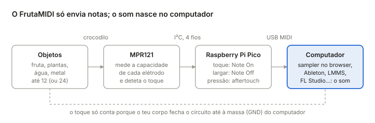
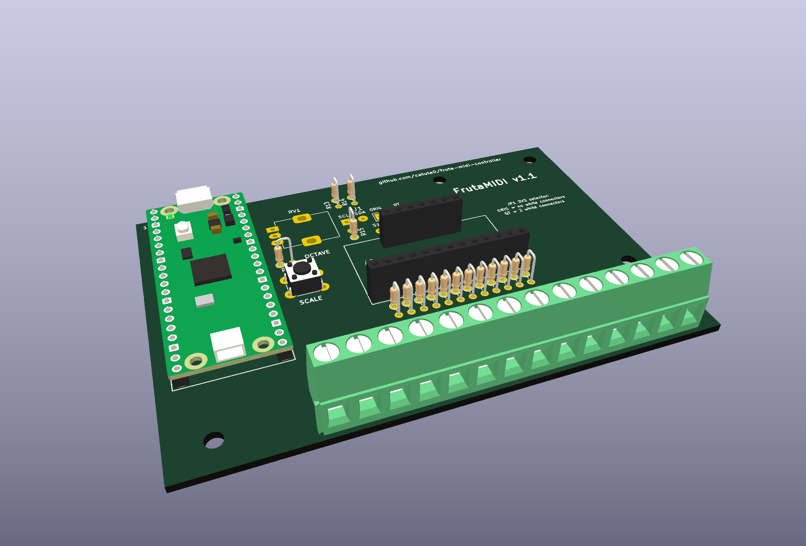
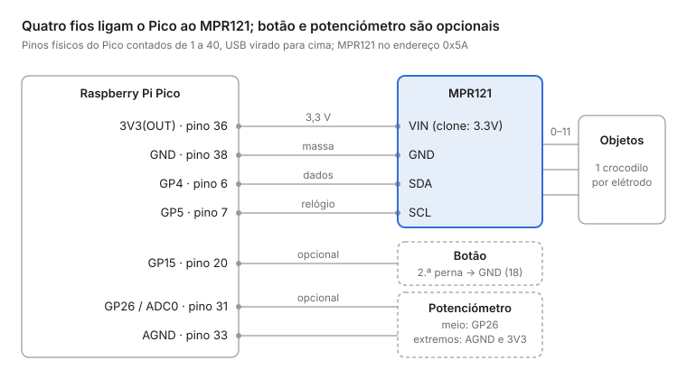

# FrutaMIDI — fruit MIDI controller

A USB MIDI controller with 12 capacitive pads (expandable to 24), in the style of the Playtron: touch a piece of fruit, a plant or a glass of water and a note comes out. It uses a Raspberry Pi Pico and an MPR121 sensor, costs about 25 € and works on **Windows and Mac** without drivers.

The MPR121 detects the touch, the Pico turns it into MIDI notes and the computer makes the sound. To change sounds, just change programs: the hardware stays the same.

**Online sampler:** <https://catuta0.github.io/fruta-midi-controller/> (open it in Edge or Chrome)

**Two ways to build it:**
- **Breadboard:** no soldering. This README.
- **Single-sided PCB, version 1.3**, for etching at home with the chemical method, with KiCad schematic, BOM and assembly guide: [`hardware/`](hardware/).
  The board has one copper layer, on the component side, and every part is surface-mounted (SMD), so the only holes are the 4 optional M3 mounting holes. All parts are sold by Mouser; one board costs about 13.84 EUR at Mouser Portugal prices of 2026-11-11, excluding shipping and tax (a calculation from list prices). What to know before you start (details in the [assembly guide](hardware/README.md)):
  - The **Pico is soldered flat** on its castellations and the **MPR121 module stands on its header pins**, both soldered onto surface pads, with no sockets. Only the Pico (SC0915) and the Pico 2 are supported on the PCB, not Pico W or Pico 2 W; with a Pico 2, check that the USB plug seats fully before soldering it. Flash the firmware before soldering the Pico. Replacing a failed one means desoldering it, which is harder than with sockets.
  - **USB end:** two small beads of 2-part epoxy along the long sides of the Pico, over pins 1–3 and 38–40; none on the USB end face or beyond the board edge, and check again after curing that the plug seats fully. Use a strain-relieved USB cable and do not lever on the plug.
  - **Electrode wires** are soldered onto pads and held with hot-melt glue. The **octave potentiometer** sits off the board on 3 wires: use one with an insulated shaft and a plastic knob. It has no bushing; the guide suggests mounting it on a small piece of perfboard behind the panel hole (not tried).
  - Module configuration: **JP1** is a surface solder bridge (ORIG or QT), set **before the module is fitted** because the module hides the ORIG label, and **J1** takes two short wire links.
  - **ESD:** each electrode has a 3.3 kΩ chip resistor. It is **not proven** that these standard resistors survive the project's ±4 kV static-discharge target; nothing has been tested (see [Safety](#design-notes) below).

> The firmware compiles without errors for all the boards listed, and the sampler was tested with simulated MIDI. <!-- EVIDENCE --> The complete build has not yet been tested on real hardware: if you run into problems, open an *issue*.

## Contents

- [Quick start (no programming)](#quick-start-no-programming)
- [PCB version](hardware/) (separate page)
- [Bill of materials](#bill-of-materials)
- [Wiring](#wiring)
- [Firmware](#firmware)
- [Sound](#sound)
- [Windows: what to know](#windows-what-to-know)
- [Design notes](#design-notes)
- [Step-by-step assembly](#step-by-step-assembly)
- [Troubleshooting](#troubleshooting)

## Quick start (no programming)

Works on Windows 10/11 and macOS; you do not need to install anything.

1. Build the hardware: see [Wiring](#wiring).
2. On the [Releases](https://github.com/catuta0/fruta-midi-controller/releases/latest) page, download the file for your board:

   | Board | Breadboard | FrutaMIDI PCB |
   | --- | --- | --- |
   | Raspberry Pi Pico | `FrutaMIDI-rpipico.uf2` | `FrutaMIDI-pcb-rpipico.uf2` |
   | Raspberry Pi Pico W | `FrutaMIDI-rpipicow.uf2` | `FrutaMIDI-pcb-rpipicow.uf2` (not supported on the v1.3 PCB, see below) |
   | Raspberry Pi Pico 2 | `FrutaMIDI-rpipico2.uf2` | `FrutaMIDI-pcb-rpipico2.uf2` |
   | Raspberry Pi Pico 2 W | `FrutaMIDI-rpipico2w.uf2` | `FrutaMIDI-pcb-rpipico2w.uf2` (not supported on the v1.3 PCB, see below) |

   The PCB uses different pins from the breadboard, so each build has its own file.

   The v1.3 PCB supports only the Raspberry Pi Pico (SC0915, recommended) and the Pico 2. Pico W and Pico 2 W are not supported on the PCB until their undersides have been checked against the keep-outs under the Pico ([assembly guide, A1](hardware/README.md#bill-of-materials)). On the breadboard all four boards work.

3. Hold the Pico's **BOOTSEL** button while you plug in the USB cable. A drive called **RPI-RP2** (Pico 2: **RP2350**) appears in Windows File Explorer or the Mac Finder.
4. Drag the `.uf2` onto that drive. The Pico restarts by itself and the drive disappears: this is normal.
5. Open the [online sampler](https://catuta0.github.io/fruta-midi-controller/) in Edge or Chrome. Click to enable sound and allow MIDI access.
6. Touch the fruit.

## Bill of materials

The essentials cost about 23–31 €. This total excludes the 14 recommended resistors (and, on the PCB, the JP1 solder bridge), because their price is not sourced. Prices are approximate and vary a lot between shops.

| Part | Qty | Purpose | Approx. price | Notes |
| --- | --- | --- | --- | --- |
| Raspberry Pi Pico or Pico 2 (**H** version, with headers already soldered) | 1 | Brain; shows up on the computer as a MIDI device | 5–7 € | Pico W and Pico 2 W also work |
| MPR121 breakout (Adafruit 1982 or CJMCU-121 clone) | 1 | 12 capacitive sensors | 3 € (clone) / 9 € (Adafruit) | Both run at 3.3 V, like the Pico |
| Micro-USB **data** cable | 1 | Connection to the computer | 3 € | Many cables are charge-only; if the Pico does not show up, it is the cable |
| 400-point breadboard | 1 | Solderless prototype | 3 € | |
| Male-to-male jumper wires | 10 | Breadboard connections | 2 € | |
| Leads with alligator clips on both ends | 12 | Connect each pad to an object | 5 € (pack of 10) | Buy 2 packs |
| Screw terminal strip, 12 ways | 1 | Sturdy connection point for the alligator clips | 2 € | 5 mm pitch is the easiest to tighten |
| Resistor 3.3 kΩ (3k3), axial | 12 | One in series with each electrode (ESD protection) | — | Recommended. The PCB (v1.3) uses 3.3 kΩ ±1 % surface-mount chip resistors in the 2512 size (YAGEO RC2512FK-073K3L); see the [assembly guide](hardware/README.md#bill-of-materials) |
| Resistor 4.7 kΩ (4k7), axial | 2 | I²C pull-ups, SDA and SCL to 3V3 | — | Recommended, because the firmware runs I²C at 400 kHz (Yageo MFR-12FTF52-4K7) |
| 6 mm push button | 1 | Change scale / recalibrate | 0.20 € | Optional, but very useful |
| 10 kΩ linear potentiometer (B10K) + knob | 1 | Change octave | 1.50 € | Optional |
| Second MPR121 | 1 | Pads 13 to 24 | 3–9 € | Optional |
| Project box ~100×60×25 mm or 3D print | 1 | Protect the electronics | 5 € | Optional |
| Perfboard + soldering iron | 1 | Permanent version | 3 € | After testing on the breadboard |
| Stainless steel nails or needles, copper tape, conductive paint | — | Electrodes | 5–10 € | Optional |

The firmware also compiles for the Arduino Pro Micro / Leonardo (ATmega32u4). In that case, use an Adafruit MPR121 (it accepts 5 V) or a 3.3 V Pro Micro: MPR121 clones only tolerate 3.3 V.

## Wiring

| Pico (GP) | Physical pin | Connects to | Function |
| --- | --- | --- | --- |
| 3V3(OUT) | 36 | MPR121 **VIN** (Adafruit) or **3.3V** (clone) | Sensor power |
| GND | 38 | MPR121 **GND** | Common ground |
| GP4 | 6 | MPR121 **SDA** | I²C data |
| GP5 | 7 | MPR121 **SCL** | I²C clock |
| — | — | MPR121 **IRQ** | Not connected: the firmware polls the sensor in a loop |
| — | — | MPR121 **ADDR** | Leave as is (0x5A); only changes on the 2nd sensor |
| GP15 | 20 | Button, leg 1 | Scale / recalibrate; the other leg goes to GND (pin 18) |
| GP26 / ADC0 | 31 | Potentiometer, middle pin | Octave (optional) |
| 3V3(OUT) | 36 | Potentiometer, one end | |
| AGND | 33 | Potentiometer, other end | |
| 3V3(OUT) | 36 | 4.7 kΩ resistor to SDA (GP4), and another 4.7 kΩ to SCL (GP5) | I²C pull-ups (recommended) |
| — | — | MPR121 **0–11** | Each pin through its own 3.3 kΩ resistor to the terminal strip, then one alligator clip per object |

Physical pins are counted from 1 to 40 with the USB facing up: pin 1 is the top-left corner, you go down the left side to 20 and back up the right side to 40.

**Second MPR121 (24 pads).** Connect it in parallel with the first, on the same 3V3, GND, SDA and SCL. To change its address to 0x5B, connect its **ADDR** pin to 3V3. On the clone, ADDR usually comes tied to GND by a trace or solder bridge that you must cut first. In the firmware, set `NUM_SENSORS = 2`; the `.uf2` files in Releases are for 1 sensor. With `NUM_SENSORS = 2`, an LED that keeps blinking fast means one of the two modules is not answering.

**Pro Micro / Leonardo.** SDA = pin 2, SCL = pin 3, button on pin 7, potentiometer on A0.

**Protection and pull-ups (recommended).** Put a 3.3 kΩ resistor in series between each MPR121 electrode pin (0–11) and its terminal, so the resistor sits between the sensor and anything you touch. Add two 4.7 kΩ pull-ups from 3V3 to SDA and to SCL: the firmware runs I²C at 400 kHz. These are the same values used on the [PCB](hardware/README.md#electrical-safety).

Keep the I²C wires short (under 10 cm). The leads to the fruit can be 20–50 cm, but kept apart from each other.

## Firmware

The code is in [`firmware/FrutaMIDI/FrutaMIDI.ino`](firmware/FrutaMIDI/FrutaMIDI.ino), with helper headers `fm_*.h` in the same folder. The scales are defined in [`fm_scales.h`](firmware/FrutaMIDI/fm_scales.h). You only need to compile it if you want to change the configuration; otherwise, use the `.uf2` files from the [Quick start](#quick-start-no-programming).

**What it does**

- Each touched pad sends Note On; when you let go, it sends Note Off for the same note, even if you have changed scale in the meantime.
- While you touch, it sends Polyphonic Aftertouch (0–127): more skin, or the hand closer, gives a higher value. When you let go, it sends aftertouch 0 before the Note Off, so the pressure never stays stuck. After an octave change two pads can play the same note: it sounds until the last of them is released.
- It has 6 scales. It starts in Drum Rack mode (notes 36–47, for triggering samples); the others are melodic.
- Button: a short press moves to the next scale and the LED blinks its number (1 Drum Rack · 2 Major pentatonic · 3 Minor pentatonic · 4 Major · 5 Natural minor · 6 Chromatic). Held for 0.8 s, it recalibrates.
- LED: 2 slow blinks at startup = sensor OK; blinking fast = MPR121 not found or lost during play (its notes are released and it retries about every 2 s); on = pad touched. The pads keep playing while the LED blinks; while a blink pattern runs, the LED shows the pattern instead of touches.

**Compiling (Arduino IDE 2, same on Windows and Mac)**

1. In the Arduino IDE preferences (*File → Preferences* on Windows, *Arduino IDE → Settings* on Mac), add this address to *Additional boards manager URLs*:
   `https://github.com/earlephilhower/arduino-pico/releases/download/global/package_rp2040_index.json`
2. In the *Boards Manager*, install **Raspberry Pi Pico/RP2040/RP2350** (Earle F. Philhower).
3. In the *Library Manager*, install **Adafruit MPR121** (accept the dependencies) and **MIDI Library** (FortySevenEffects). For the Pro Micro, install **MIDIUSB** instead of the MIDI Library.
4. Under *Tools*: *Board* → your board; *USB Stack* → **Adafruit TinyUSB**. Without this step it does not compile.
5. First upload: hold **BOOTSEL** while you plug in the USB and click *Upload*. Later uploads are automatic (on Windows, the Pico shows up as a COM port).

**Configuration** (at the top of the file)

| Constant | Default | Purpose |
| --- | --- | --- |
| `NUM_SENSORS` | 1 | 2 for 24 pads |
| `MIDI_CHANNEL` | 1 | MIDI channel (1–16) |
| `VELOCITY` | 100 | Fixed note velocity |
| `TOUCH_THRESHOLD` / `RELEASE_THRESHOLD` | 12 / 6 | Sensitivity: higher = less sensitive |
| `AUTOCONFIG` | true | Adjusts the charge current to the size of each object. Leave it on for fruit |
| `SEND_AFTERTOUCH` | true | Sends the "pressure" as Polyphonic Aftertouch |
| `USE_BUTTON` / `USE_POT` | true / false | Enables the button and the potentiometer |
| `SERIAL_DEBUG` | false | Prints each pad's "delta" to the Serial Monitor (115200) |
| `#define FRUTAMIDI_PCB` | off | Uncomment for the [PCB](hardware/): I²C on GP26/GP27, button on GP22, potentiometer on GP28 (and enabled) |

**Tuning the sensitivity:** set `SERIAL_DEBUG = true`, upload the firmware again and open the Serial Monitor. You see each pad's delta 4 times per second: close to 0 at rest, rising when you touch. `TOUCH_THRESHOLD` should sit roughly in the middle.

## Sound

FrutaMIDI does not make sound: it sends notes. Choose a program to turn them into sound.

**Browser sampler (included).** Open <https://catuta0.github.io/fruta-midi-controller/> in **Edge** (it comes with Windows) or Chrome. Safari does not have Web MIDI. The file is at [`docs/index.html`](docs/index.html) and also works when downloaded.

- 12 pads with synthesised drum sounds, mapped to notes 36–47 (the firmware's Drum Rack mode).
- Drag a wav, mp3 or ogg onto a pad to replace its sound.
- The **"learn"** button changes a pad's note: click it and touch the fruit.
- Notes without a pad (melodic scales) play on a synthesiser, and aftertouch opens the filter.
- Without hardware, the keys 1–4 / Q–R / A–F play the pads.

**Music programs**

| Program | System | Cost | How to use |
| --- | --- | --- | --- |
| [LMMS](https://lmms.io) | Windows, Mac, Linux | Free | *AudioFileProcessor* or *Kicker* instrument; enable MIDI input on the track |
| [Ableton Live](https://www.ableton.com/live/) | Windows, Mac | Paid, with trial version | Drum Rack (C1–B1 = notes 36–47); *Settings → Link, Tempo & MIDI* → enable **Track** on the FrutaMIDI input |
| [FL Studio](https://www.image-line.com) | Windows, Mac | Paid, with trial version | *FPC* for pads; enable FrutaMIDI in *Options → MIDI settings* |
| [Reaper](https://www.reaper.fm) | Windows, Mac | Free trial, cheap licence | Track with *ReaSamplOmatic5000*; MIDI record input → FrutaMIDI |
| GarageBand | Mac only | Free | *Software Instrument* track; recognises FrutaMIDI by itself |

For the classic "Playtron" effect (the sound lasts while your hand is on the fruit), use the DAW's sampler in *gate* or *hold* mode, not *one-shot*.

## Windows: what to know

- **No drivers.** Windows 10 and 11 recognise FrutaMIDI by themselves. To check, open *Device Manager*: it appears under *Sound, video and game controllers*.
- **One program at a time.** On Windows, a MIDI device can normally be opened by only one program at a time. If the DAW says FrutaMIDI is unavailable, close the sampler tab in the browser (and vice versa). The sampler warns you when the device is busy. The most recent versions of Windows 11 include *Windows MIDI Services*, which may lift this limitation.
- **Latency.** In the DAW, use an **ASIO** driver: your sound card's or, on a laptop without one, the free [ASIO4ALL](https://asio4all.org) or [FlexASIO](https://github.com/dechamps/FlexASIO). Set the buffer to 128 or 256 samples. With the standard driver (MME/shared WASAPI) the delay is noticeable.
- **Device name.** Windows keeps the name of the first device it saw with that USB identifier. If you have used the Pico with other firmware before, it may show up under another name; it works all the same.
- **Laptop on battery.** As on the Mac, sensitivity drops when the laptop is not plugged into the charger (see [Design notes](#design-notes)).

## Design notes

What matters most for the result is not the code: it is the objects, the cables and the ground connection. The MPR121 measures the capacitance of each electrode. When you touch it, your body, grounded through the floor and the computer, adds capacitance and the reading drops. The "delta" is that drop.

**Ground and computer**

- The circuit closes through you and the computer. A laptop on battery gives smaller, unstable deltas; plugged into the charger it usually improves.
- Makey Makey trick: an alligator clip connected to the Pico's GND on a wristband or on a "ground" object. Anyone touching it with the other hand gets a much stronger and more consistent touch.

**Which objects work**

- Good: fruit and vegetables with water in them (lemon, apple, cucumber, potato), thick-leaved plants, water in a glass, metal, copper tape, conductive paint, heavily shaded 6B pencil drawings, homemade salt dough.
- Bad: dry wood, plastic, glass, very dry fruit or fruit with a thick, dry skin.
- Objects must not touch each other or sit on a wet surface: that shorts pads together.
- For long events, hard vegetables (potato, carrot, apple) last for days; bananas and strawberries spoil quickly.

**Connecting to the object**

- An alligator clip on the skin alone works poorly. Push in a stainless steel nail or needle, or 1–2 cm of stripped wire, and clip onto that.
- Fruit acid oxidises copper within a few hours. Stainless steel lasts much longer.

**Cables**

- The cable itself is part of the electrode: touching the wire also triggers the note, and long cables pick up noise.
- Use up to 50 cm per cable, kept apart from each other. Do not use flat multi-conductor cable or tied bundles: touching one wire triggers its neighbour (crosstalk).

**Calibration and sensitivity**

- At startup, the MPR121 measures each electrode's "baseline" and, with `AUTOCONFIG`, adjusts the charge current to the size of the object. Connect the fruit before the USB, or hold the button for 0.8 s after swapping objects, without touching anything.
- Ghost notes: raise the thresholds to 20 / 10. No response: lower them to 8 / 4. Measure first with `SERIAL_DEBUG`.
- Very large objects (a whole watermelon, a pot of damp soil) can fall outside the sensor's range: the pad stays on all the time or never turns on. Use a smaller object or a piece of it.

**Enclosure and permanent version**

- After testing on the breadboard, solder everything onto a perfboard. Put the Pico in a female header so you can remove it.
- Terminal strip or 4 mm binding posts on the lid, numbered 0–11, and holes for the USB and the button.
- Use a plastic or wooden box: metal near the electrodes takes away sensitivity.

**Safety.** FrutaMIDI is USB-powered with 3.3 V logic. On the [PCB (v1.3)](hardware/README.md#electrical-safety), each electrode has a 3.3 kΩ series chip resistor (2512 size) and sits next to a spark gap to GND. The protection target is an IEC 61000-4-2 contact discharge of ±4 kV, and that target is itself an assumption. Whether the resistors survive it is **not proven**: they are standard parts with no published surge rating, a choice accepted to keep the board cheap. If the planned physical ESD test shows damage (a resistor whose value shifts, a channel that stops detecting touch, or a spark across a resistor), the fallback is a board revision with clamp diodes. Nothing has been tested, and the board does not cover 8 kV. The PCB has not been evaluated beyond that. Use an insulated-shaft potentiometer with a plastic knob on the PCB: a metal shaft is not protected. The breadboard build has no ESD protection on the electrodes beyond the MPR121's internal protection (HBM ±2 kV): the module connects its electrode pins straight to its header. The recommended 3.3 kΩ series resistors (see [Wiring](#wiring)) have the same value as the PCB's protection, but a small resistor is not rated for the ESD pulse, and no resistor has been evaluated in a breadboard layout. Neither build has been evaluated for touching while connected to mains-powered equipment. <!-- EVIDENCE --> Never connect the electrodes to anything plugged into mains power.

## Step-by-step assembly

Test each step before moving on: when something fails, you know straight away where the problem is.

1. **Pico alone.** Upload the firmware with only the Pico connected. The LED should blink fast, because there is no sensor yet, and FrutaMIDI already shows up in the sampler.
2. **Sensor.** With the USB unplugged, place the Pico and the MPR121 on the breadboard and connect the 4 wires: 3V3, GND, SDA and SCL, plus the two 4.7 kΩ pull-ups (3V3 to SDA, 3V3 to SCL). When you plug in the USB: 2 slow blinks, then the LED off.
3. **First touch.** Touch pin 0 of the MPR121 directly with your finger. The LED lights up and the sampler shows "Note On C1 (36)".
4. **First fruit.** One alligator lead from pin 0 to a nail pushed into a lemon. Recalibrate (0.8 s on the button, or unplug and replug the USB) without touching anything, then touch the lemon.
5. **Tune.** If there are ghost notes or missed touches, adjust the thresholds (see [Design notes](#design-notes)).
6. **All 12 pads.** Add the terminal strip, with a 3.3 kΩ resistor between each MPR121 pin and its terminal, and the rest of the fruit, recalibrate, and test pad by pad in the sampler.
7. **Controls.** Add the button (GP15 ↔ GND) and, if you like, the potentiometer with `USE_POT = true`.
8. **Final version.** Move to the perfboard and the enclosure.

## Troubleshooting

| Symptom | Likely cause | What to do |
| --- | --- | --- |
| Compile error mentioning `Adafruit_TinyUSB` or `usbMidi` | Wrong USB Stack | *Tools → USB Stack → Adafruit TinyUSB* |
| The Pico does not show up at all | Charge-only cable | Change the cable; test with BOOTSEL held (the RPI-RP2 drive should appear) |
| LED keeps blinking fast | MPR121 not responding on I²C | Check 3V3/GND and that SDA→GP4 and SCL→GP5 are not swapped; on the 2nd sensor, check ADDR |
| Windows: the DAW does not see FrutaMIDI, or the sampler says "ocupado" (busy) | Another program has the device open | Close the other program (or the sampler tab) and reopen |
| It shows up, but the DAW does not play | MIDI input disabled or track not armed | Enable the FrutaMIDI input in the DAW's MIDI settings and arm the track |
| Windows: the sound arrives late | Audio driver without ASIO | Use ASIO (ASIO4ALL or FlexASIO) with a buffer of 128–256 |
| A pad is always on | It calibrated with a hand on the object, or the object is too large | Recalibrate without touching; use a smaller object; raise the threshold |
| Touching one pad triggers its neighbour | Wires together or objects touching | Move the cables apart and separate the objects; dry the table |
| Ghost notes when the hand gets close | Low threshold or long cables | Raise to 20 / 10; shorten the cables |
| Sensitivity changes over the day | Fruit drying out, laptop on battery | Recalibrate; plug in the charger; use the ground-wire trick |
| A note gets stuck in the DAW | You unplugged the USB with a hand on the object | Touch and release the same pad again: the Note Off frees the note |
| The sampler says there is no Web MIDI | Safari, or an old browser | Use Edge or Chrome |

## Licence

[MIT](LICENSE): you are free to use, modify and share it.
