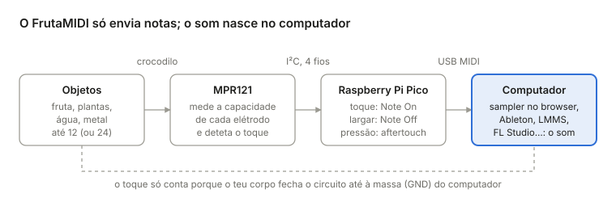
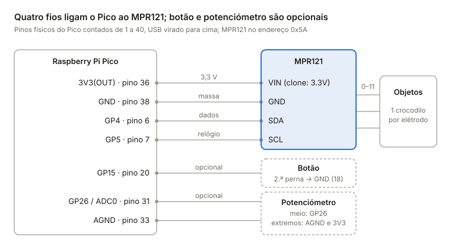

# FrutaMIDI — controlador MIDI de fruta

Um controlador MIDI USB de 12 pads capacitivos (expansível a 24), ao estilo do Playtron: tocas numa fruta, numa planta ou num copo de água e sai uma nota. Usa um Raspberry Pi Pico e um sensor MPR121, custa cerca de 25 € e funciona em **Windows e Mac** sem drivers.

O MPR121 deteta o toque, o Pico traduz-o em notas MIDI e o computador faz o som. Para trocar de sons basta trocar de programa: o hardware fica igual.

**Sampler online:** <https://catuta0.github.io/fruta-midi-controller/> (abre no Edge ou no Chrome)

> O firmware compila sem erros para todas as placas listadas e o sampler foi testado com MIDI simulado. A montagem completa ainda não foi testada em hardware real: se encontrares problemas, abre uma *issue*.

## Conteúdo

- [Início rápido (sem programar)](#início-rápido-sem-programar)
- [Lista de material](#lista-de-material)
- [Ligações](#ligações)
- [Firmware](#firmware)
- [Som](#som)
- [Windows: o que saber](#windows-o-que-saber)
- [Notas de design](#notas-de-design)
- [Montagem passo a passo](#montagem-passo-a-passo)
- [Resolução de problemas](#resolução-de-problemas)

## Início rápido (sem programar)

Serve para Windows 10/11 e macOS; não precisas de instalar nada.

1. Monta o hardware: ver [Ligações](#ligações).
2. Na página [Releases](https://github.com/catuta0/fruta-midi-controller/releases/latest), descarrega o ficheiro da tua placa:

   | Placa | Ficheiro |
   | --- | --- |
   | Raspberry Pi Pico | `FrutaMIDI-rpipico.uf2` |
   | Raspberry Pi Pico W | `FrutaMIDI-rpipicow.uf2` |
   | Raspberry Pi Pico 2 | `FrutaMIDI-rpipico2.uf2` |
   | Raspberry Pi Pico 2 W | `FrutaMIDI-rpipico2w.uf2` |

3. Segura o botão **BOOTSEL** do Pico enquanto ligas o cabo USB. Aparece uma drive chamada **RPI-RP2** (Pico 2: **RP2350**): no Explorador de Ficheiros do Windows ou no Finder do Mac.
4. Arrasta o `.uf2` para essa drive. O Pico reinicia sozinho e a drive desaparece: é normal.
5. Abre o [sampler online](https://catuta0.github.io/fruta-midi-controller/) no Edge ou no Chrome. Clica para ativar o som e autoriza o acesso MIDI.
6. Toca na fruta.

## Lista de material

O essencial custa cerca de 23–31 €. Os preços são aproximados e variam muito entre lojas.

| Peça | Qtd | Para quê | Preço aprox. | Notas |
| --- | --- | --- | --- | --- |
| Raspberry Pi Pico ou Pico 2 (versão **H**, já com pinos soldados) | 1 | Cérebro; aparece no computador como dispositivo MIDI | 5–7 € | O Pico W e o Pico 2 W também servem |
| Breakout MPR121 (Adafruit 1982 ou clone CJMCU-121) | 1 | 12 sensores capacitivos | 3 € (clone) / 9 € (Adafruit) | Ambos funcionam a 3,3 V, como o Pico |
| Cabo micro-USB **de dados** | 1 | Ligação ao computador | 3 € | Muitos cabos são só de carga; se o Pico não aparecer, é o cabo |
| Breadboard 400 pontos | 1 | Protótipo sem soldar | 3 € | |
| Fios jumper macho-macho | 10 | Ligações na breadboard | 2 € | |
| Cabos com crocodilos nas duas pontas | 12 | Ligar cada pad a um objeto | 5 € (pack de 10) | Compra 2 packs |
| Régua de terminais de parafuso, 12 vias | 1 | Ponto de ligação robusto para os crocodilos | 2 € | Passo de 5 mm é o mais fácil de apertar |
| Botão de pressão 6 mm | 1 | Mudar escala / recalibrar | 0,20 € | Opcional, mas muito útil |
| Potenciómetro 10 kΩ linear (B10K) + botão rotativo | 1 | Mudar de oitava | 1,50 € | Opcional |
| Segundo MPR121 | 1 | Pads 13 a 24 | 3–9 € | Opcional |
| Caixa de projeto ~100×60×25 mm ou impressão 3D | 1 | Proteger a eletrónica | 5 € | Opcional |
| Placa perfurada + ferro de soldar | 1 | Versão definitiva | 3 € | Depois de testar na breadboard |
| Pregos ou agulhas de inox, fita de cobre, tinta condutora | — | Elétrodos | 5–10 € | Opcional |

O firmware também compila para o Arduino Pro Micro / Leonardo (ATmega32u4). Nesse caso, usa um MPR121 da Adafruit (aceita 5 V) ou um Pro Micro de 3,3 V: os clones de MPR121 só aguentam 3,3 V.

## Ligações

| Pico (GP) | Pino físico | Liga a | Função |
| --- | --- | --- | --- |
| 3V3(OUT) | 36 | MPR121 **VIN** (Adafruit) ou **3.3V** (clone) | Alimentação do sensor |
| GND | 38 | MPR121 **GND** | Massa comum |
| GP4 | 6 | MPR121 **SDA** | Dados I²C |
| GP5 | 7 | MPR121 **SCL** | Relógio I²C |
| — | — | MPR121 **IRQ** | Não se liga: o firmware lê o sensor em ciclo |
| — | — | MPR121 **ADDR** | Deixa como está (0x5A); só muda no 2.º sensor |
| GP15 | 20 | Botão, perna 1 | Escala / recalibrar; a outra perna vai a GND (pino 18) |
| GP26 / ADC0 | 31 | Potenciómetro, pino do meio | Oitava (opcional) |
| 3V3(OUT) | 36 | Potenciómetro, um extremo | |
| AGND | 33 | Potenciómetro, outro extremo | |
| — | — | MPR121 **0–11** | Um crocodilo por objeto, via régua de terminais |

Os pinos físicos contam-se de 1 a 40 com o USB virado para cima: o 1 é o canto superior esquerdo, desce-se pelo lado esquerdo até ao 20 e sobe-se pelo direito até ao 40.

**Segundo MPR121 (24 pads).** Liga-o em paralelo ao primeiro, nos mesmos 3V3, GND, SDA e SCL. Para mudar o endereço para 0x5B, liga o pino **ADDR** dele a 3V3. No clone, o ADDR costuma vir ligado a GND por uma pista ou ponte de solda que tens de cortar primeiro. No firmware, põe `NUM_SENSORS = 2`; os ficheiros `.uf2` dos Releases são para 1 sensor.

**Pro Micro / Leonardo.** SDA = pino 2, SCL = pino 3, botão no pino 7, potenciómetro em A0.

Mantém os fios do I²C curtos (menos de 10 cm). Os cabos para as frutas podem ter 20–50 cm, mas separados uns dos outros.

## Firmware

O código está em [`firmware/FrutaMIDI/FrutaMIDI.ino`](firmware/FrutaMIDI/FrutaMIDI.ino). Só precisas de o compilar se quiseres mudar a configuração; senão, usa os `.uf2` do [Início rápido](#início-rápido-sem-programar).

**O que faz**

- Cada pad tocado envia Note On; ao largar, envia Note Off da mesma nota, mesmo que entretanto tenhas mudado de escala.
- Enquanto tocas, envia Polyphonic Aftertouch (0–127): mais pele ou a mão mais perto dá um valor mais alto.
- Tem 6 escalas. Arranca em modo Drum Rack (notas 36–47, para disparar samples); as outras são melódicas.
- Botão: toque curto passa à escala seguinte e o LED pisca o número dela (1 Drum Rack · 2 Pentatónica maior · 3 Pentatónica menor · 4 Maior · 5 Menor natural · 6 Cromática). Premido 1 s, recalibra.
- LED: 2 piscadelas lentas no arranque = sensor OK; a piscar depressa = MPR121 não encontrado (tenta de novo a cada 2 s); aceso = pad tocado.

**Compilar (Arduino IDE 2, igual em Windows e Mac)**

1. Nas preferências do Arduino IDE (*File → Preferences* no Windows, *Arduino IDE → Settings* no Mac), junta este endereço a *Additional boards manager URLs*:
   `https://github.com/earlephilhower/arduino-pico/releases/download/global/package_rp2040_index.json`
2. No *Boards Manager*, instala **Raspberry Pi Pico/RP2040/RP2350** (Earle F. Philhower).
3. No *Library Manager*, instala **Adafruit MPR121** (aceita as dependências) e **MIDI Library** (FortySevenEffects). Para o Pro Micro, instala **MIDIUSB** em vez da MIDI Library.
4. Em *Tools*: *Board* → a tua placa; *USB Stack* → **Adafruit TinyUSB**. Sem este passo não compila.
5. Primeiro upload: segura o **BOOTSEL** enquanto ligas o USB e carrega em *Upload*. Os seguintes já são automáticos (no Windows, o Pico aparece como porta COM).

**Configuração** (no topo do ficheiro)

| Constante | Por defeito | Para quê |
| --- | --- | --- |
| `NUM_SENSORS` | 1 | 2 para 24 pads |
| `MIDI_CHANNEL` | 1 | Canal MIDI (1–16) |
| `VELOCITY` | 100 | Velocidade fixa das notas |
| `TOUCH_THRESHOLD` / `RELEASE_THRESHOLD` | 12 / 6 | Sensibilidade: mais alto = menos sensível |
| `AUTOCONFIG` | true | Ajusta a corrente de carga ao tamanho de cada objeto. Deixa ligado para fruta |
| `SEND_AFTERTOUCH` | true | Envia a "pressão" como Polyphonic Aftertouch |
| `USE_BUTTON` / `USE_POT` | true / false | Ativa o botão e o potenciómetro |
| `SERIAL_DEBUG` | false | Imprime o "delta" de cada pad no Monitor Série (115200) |

**Afinar a sensibilidade:** põe `SERIAL_DEBUG = true`, volta a carregar o firmware e abre o Monitor Série. Vês o delta de cada pad 4 vezes por segundo: perto de 0 em repouso, a subir quando tocas. O `TOUCH_THRESHOLD` deve ficar mais ou menos a meio.

## Som

O FrutaMIDI não faz som: envia notas. Escolhe um programa para as transformar em som.

**Sampler no browser (incluído).** Abre <https://catuta0.github.io/fruta-midi-controller/> no **Edge** (já vem no Windows) ou no Chrome. O Safari não tem Web MIDI. O ficheiro está em [`docs/index.html`](docs/index.html) e também funciona descarregado.

- 12 pads com sons de bateria sintetizados, mapeados às notas 36–47 (o modo Drum Rack do firmware).
- Arrasta um wav, mp3 ou ogg para cima de um pad para o substituir.
- "aprender" muda a nota de um pad: carregas e tocas na fruta.
- As notas sem pad (escalas melódicas) tocam num sintetizador, e o aftertouch abre o filtro.
- Sem hardware, as teclas 1–4 / Q–R / A–F tocam os pads.

**Programas de música**

| Programa | Sistema | Custo | Como usar |
| --- | --- | --- | --- |
| [LMMS](https://lmms.io) | Windows, Mac, Linux | Grátis | Instrumento *AudioFileProcessor* ou *Kicker*; ativa a entrada MIDI na faixa |
| [Ableton Live](https://www.ableton.com/live/) | Windows, Mac | Pago, com versão de teste | Drum Rack (C1–B1 = notas 36–47); *Settings → Link, Tempo & MIDI* → ativa **Track** na entrada FrutaMIDI |
| [FL Studio](https://www.image-line.com) | Windows, Mac | Pago, com versão de teste | *FPC* para pads; ativa o FrutaMIDI em *Options → MIDI settings* |
| [Reaper](https://www.reaper.fm) | Windows, Mac | Teste grátis, licença barata | Faixa com *ReaSamplOmatic5000*; entrada de gravação MIDI → FrutaMIDI |
| GarageBand | Só Mac | Grátis | Faixa *Software Instrument*; reconhece o FrutaMIDI sozinho |

Para o efeito "Playtron" clássico (o som dura enquanto a mão está na fruta), usa o sampler do DAW em modo *gate* ou *hold*, não em *one-shot*.

## Windows: o que saber

- **Sem drivers.** O Windows 10 e 11 reconhecem o FrutaMIDI sozinhos. Para confirmar, abre o *Gestor de Dispositivos*: aparece em *Dispositivos de som, vídeo e jogos*.
- **Um programa de cada vez.** No Windows, um dispositivo MIDI normalmente só pode ser aberto por um programa de cada vez. Se o DAW disser que o FrutaMIDI está indisponível, fecha o separador do sampler no browser (e vice-versa). O sampler avisa quando o dispositivo está ocupado. As versões mais recentes do Windows 11 trazem o *Windows MIDI Services*, que pode levantar esta limitação.
- **Latência.** No DAW, usa um driver **ASIO**: o da tua placa de som ou, num portátil sem placa, o gratuito [ASIO4ALL](https://asio4all.org) ou o [FlexASIO](https://github.com/dechamps/FlexASIO). Põe o buffer em 128 ou 256 amostras. Com o driver normal (MME/WASAPI partilhado) nota-se atraso.
- **Nome do dispositivo.** O Windows guarda o nome do primeiro dispositivo que viu com aquele identificador USB. Se já tiveres usado o Pico com outro firmware, pode aparecer com outro nome; funciona na mesma.
- **Portátil a bateria.** Tal como no Mac, a sensibilidade baixa quando o portátil não está ligado ao carregador (ver [Notas de design](#notas-de-design)).

## Notas de design

O que mais pesa no resultado não é o código: são os objetos, os cabos e a ligação à terra. O MPR121 mede a capacidade de cada elétrodo. Quando tocas, o teu corpo, ligado à terra através do chão e do computador, acrescenta capacidade e a leitura cai. O "delta" é essa queda.

**Terra e computador**

- O circuito fecha através de ti e do computador. Um portátil a bateria dá deltas mais pequenos e instáveis; ligado ao carregador costuma melhorar.
- Truque do Makey Makey: um crocodilo ligado ao GND do Pico numa pulseira ou num objeto "terra". Quem lhe tocar com a outra mão tem um toque muito mais forte e consistente.

**Que objetos funcionam**

- Bons: fruta e legumes com água (limão, maçã, pepino, batata), plantas de folha grossa, água num copo, metal, fita de cobre, tinta condutora, desenhos a lápis 6B bem carregados, plasticina caseira com sal.
- Maus: madeira seca, plástico, vidro, fruta muito seca ou com casca grossa e seca.
- Os objetos não se podem tocar entre si nem estar em cima de uma superfície molhada: isso faz curto entre pads.
- Para eventos longos, os legumes duros (batata, cenoura, maçã) aguentam dias; banana e morango estragam-se depressa.

**Ligação ao objeto**

- O crocodilo só na casca funciona mal. Espeta um prego ou agulha de inox, ou 1–2 cm de fio descarnado, e prende o crocodilo aí.
- O ácido da fruta oxida o cobre em poucas horas. O inox dura muito mais.

**Cabos**

- O próprio cabo faz parte do elétrodo: tocar no fio também dispara a nota, e cabos compridos captam ruído.
- Usa até 50 cm por cabo, separados uns dos outros. Não uses cabo plano multicondutor nem feixes atados: tocar num fio dispara o vizinho (diafonia).

**Calibração e sensibilidade**

- No arranque, o MPR121 mede a "linha de base" de cada elétrodo e, com `AUTOCONFIG`, ajusta a corrente de carga ao tamanho do objeto. Liga as frutas antes do USB, ou carrega 1 s no botão depois de trocar objetos, sem tocar em nada.
- Notas fantasma: sobe os thresholds para 20 / 10. Não reage: desce para 8 / 4. Mede primeiro com `SERIAL_DEBUG`.
- Objetos muito grandes (melancia inteira, vaso com terra húmida) podem sair da gama do sensor: o pad fica sempre ligado ou nunca liga. Usa um objeto mais pequeno ou um pedaço.

**Caixa e versão definitiva**

- Depois de testar na breadboard, solda tudo numa placa perfurada. Põe o Pico num header fêmea para o poderes tirar.
- Régua de terminais ou bornes de 4 mm na tampa, numerados 0–11, e furos para o USB e para o botão.
- Usa uma caixa de plástico ou madeira: metal perto dos elétrodos rouba sensibilidade.

**Segurança.** Tudo funciona a 3,3 V vindos do USB, por isso é seguro tocar. Nunca ligues os elétrodos a nada que esteja ligado à corrente elétrica.

## Montagem passo a passo

Testa cada passo antes de avançar: quando algo falha, sabes logo onde está o problema.

1. **Pico sozinho.** Carrega o firmware só com o Pico ligado. O LED deve piscar depressa, porque ainda não há sensor, e o FrutaMIDI já aparece no sampler.
2. **Sensor.** Com o USB desligado, coloca o Pico e o MPR121 na breadboard e liga os 4 fios: 3V3, GND, SDA e SCL. Ao ligar o USB: 2 piscadelas lentas e o LED apagado.
3. **Primeiro toque.** Toca com o dedo diretamente no pino 0 do MPR121. O LED acende e o sampler mostra "Note On C1 (36)".
4. **Primeira fruta.** Um crocodilo do pino 0 a um prego espetado num limão. Recalibra (1 s no botão, ou desliga e liga o USB) sem tocar em nada, e depois toca no limão.
5. **Afinar.** Se houver notas fantasma ou falhas, ajusta os thresholds (ver [Notas de design](#notas-de-design)).
6. **Os 12 pads.** Junta a régua de terminais e as restantes frutas, recalibra, e testa pad a pad no sampler.
7. **Controlos.** Junta o botão (GP15 ↔ GND) e, se quiseres, o potenciómetro com `USE_POT = true`.
8. **Versão final.** Passa para a placa perfurada e a caixa.

## Resolução de problemas

| Sintoma | Causa provável | O que fazer |
| --- | --- | --- |
| Erro a compilar com `Adafruit_TinyUSB` ou `usbMidi` | USB Stack errado | *Tools → USB Stack → Adafruit TinyUSB* |
| O Pico não aparece de todo | Cabo só de carga | Troca de cabo; testa com BOOTSEL premido (deve surgir a drive RPI-RP2) |
| LED a piscar depressa sem parar | MPR121 não responde no I²C | Confirma 3V3/GND e que SDA→GP4 e SCL→GP5 não estão trocados; no 2.º sensor, confirma o ADDR |
| Windows: o DAW não vê o FrutaMIDI, ou o sampler diz "ocupado" | Outro programa tem o dispositivo aberto | Fecha o outro programa (ou o separador do sampler) e reabre |
| Aparece, mas o DAW não toca | Entrada MIDI desativada ou faixa não armada | Ativa a entrada FrutaMIDI nas definições MIDI do DAW e arma a faixa |
| Windows: o som chega atrasado | Driver de áudio sem ASIO | Usa ASIO (ASIO4ALL ou FlexASIO) com buffer de 128–256 |
| Um pad está sempre ligado | Calibrou com a mão no objeto, ou o objeto é grande demais | Recalibra sem tocar; usa um objeto mais pequeno; sobe o threshold |
| Tocar num pad dispara o vizinho | Fios juntos ou objetos encostados | Afasta os cabos e separa os objetos; seca a mesa |
| Notas fantasma ao aproximar a mão | Threshold baixo ou cabos compridos | Sobe para 20 / 10; encurta os cabos |
| A sensibilidade muda ao longo do dia | Fruta a secar, portátil a bateria | Recalibra; liga o carregador; usa o truque do fio de terra |
| Uma nota fica presa no DAW | Desligaste o USB com a mão no objeto | Toca e larga outra vez o mesmo pad: o Note Off liberta a nota |
| O sampler diz que não há Web MIDI | Safari, ou browser antigo | Usa o Edge ou o Chrome |

## Licença

[MIT](LICENSE): podes usar, modificar e partilhar à vontade.
