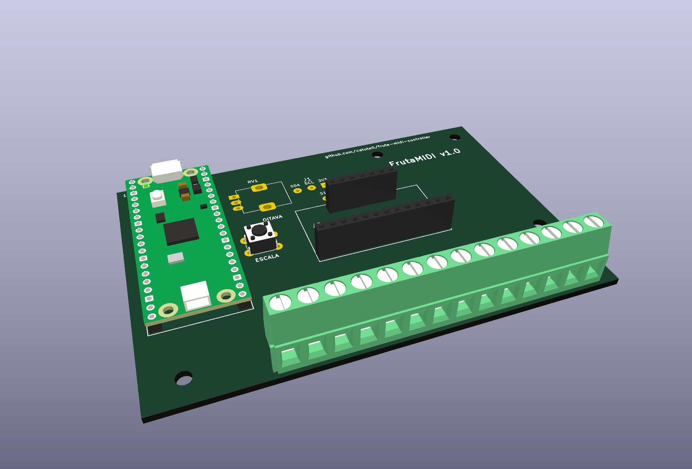
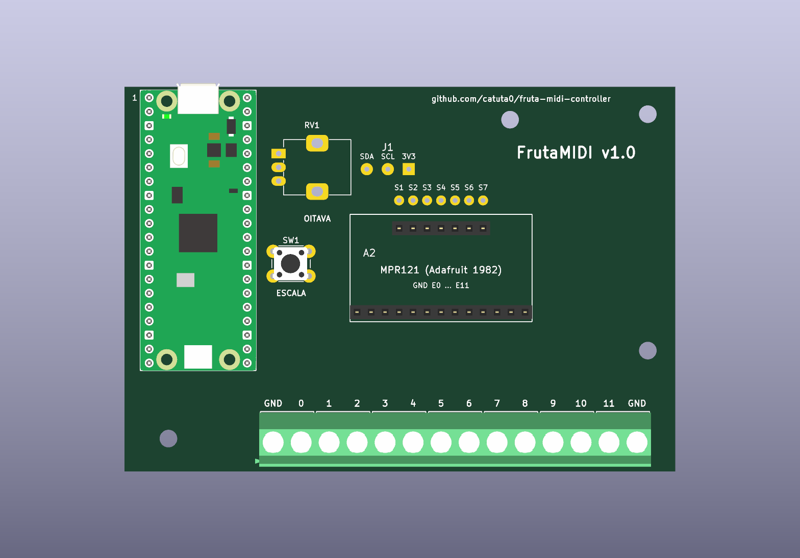

# FrutaMIDI — single-sided PCB (version 1.0)

A 100 × 70 mm board with copper on the bottom side only, designed for chemical etching at home (toner transfer or photosensitive board). It takes a Raspberry Pi Pico and an Adafruit MPR121 module (1982), both socketed, plus 14 screw terminals, a button and a potentiometer.



> **Status:** the schematic passes ERC and the PCB passes DRC, both with no violations, and the PCB matches the schematic. <!-- EVIDENCE --> The board has not yet been fabricated or physically tested. If you make one, open an *issue* with the result.

## Contents

- [Files](#files)
- [Bill of materials](#bill-of-materials)
- [Design rules for home etching](#design-rules-for-home-etching)
- [1. Print](#1-print)
- [2. Transfer and etch](#2-transfer-and-etch)
- [3. Drill](#3-drill)
- [4. Solder](#4-solder)
- [5. Module configuration wires](#5-module-configuration-wires)
- [6. Test before powering](#6-test-before-powering)
- [7. Firmware and first power-up](#7-firmware-and-first-power-up)
- [Common problems](#common-problems)
- [Modifying the board](#modifying-the-board)

## Files

| File | Purpose |
| --- | --- |
| [`fabrico/1-cobre-para-transferir.pdf`](fabrico/1-cobre-para-transferir.pdf) | **What you print** for toner or positive photosensitive board. 1:1 scale, already in the right orientation |
| [`fabrico/1b-cobre-negativo.pdf`](fabrico/1b-cobre-negativo.pdf) | The same in negative, only for dry film / negative resist |
| [`fabrico/2-mapa-de-montagem.pdf`](fabrico/2-mapa-de-montagem.pdf) | Where each component goes, seen from the top |
| [`fabrico/3-serigrafia-opcional-espelhada.pdf`](fabrico/3-serigrafia-opcional-espelhada.pdf) | Optional: transfer the labels onto the component side |
| [`fabrico/frutamidi-esquematico.pdf`](fabrico/frutamidi-esquematico.pdf) | Schematic |
| [`fabrico/gerbers/`](fabrico/gerbers/) | Gerbers + Excellon drill files, if you prefer to order the board (JLCPCB, PCBWay…) |
| [`fabrico/bom-kicad.csv`](fabrico/bom-kicad.csv) | BOM exported from KiCad |
| `frutamidi.kicad_pro` / `.kicad_sch` / `.kicad_pcb` | KiCad 10 project, with its own libraries (`FrutaMIDI.kicad_sym`, `FrutaMIDI.pretty/`) |
| [`scripts/`](scripts/) | Schematic and PCB generators, and `build_all.sh` (regenerates, checks and exports) |

## Bill of materials

### Components

| Ref. | Part | Qty | Approx. price | Notes |
| --- | --- | --- | --- | --- |
| A1 | Raspberry Pi Pico **H** (or Pico, Pico W, Pico 2, Pico 2 W with male headers soldered) | 1 | 5–8 € | The "H" comes with the pins already fitted |
| A2 | Adafruit MPR121 12-key capacitive touch breakout (**product 1982**) | 1 | 9–12 € | Original or STEMMA QT: both work (see [section 5](#5-module-configuration-wires)). Comes with the male header to solder onto the module |
| — | Female header 1×20, 2.54 mm pitch | 2 | 1 € | Pico socket |
| — | Female header 1×13, 2.54 mm pitch | 1 | 0.50 € | Module electrode row |
| — | Female header 1×7, 2.54 mm pitch | 1 | 0.40 € | Module power/I²C row |
| J2 | 2-way screw terminal block, **5.08 mm** pitch, interlocking (KF301-2P, Phoenix MKDS 1,5/2-5,08 or equivalent) | 7 | 2–3 € | They lock together to form the 14-way strip |
| SW1 | 6 × 6 mm push button, 4 legs | 1 | 0.20 € | Choose the height to suit the enclosure |
| RV1 | 10 kΩ linear potentiometer (B10K), 9 mm, vertical, Alps RK09K type | 1 | 1 € | Plus a knob |
| — | Thin insulated solid wire (from network cable, for example) | ~10 cm | — | 3 configuration wires |
| H1–H4 | M3 screws + spacers | 4 | 2 € | Optional |
| — | Micro-USB **data** cable | 1 | 3 € | |

If you cut 40-way female header to length, you lose one pin at each cut: 3 strips of 1×40 are just enough for 20 + 20 + 13 + 7.

### Fabrication materials

| Part | Qty | Notes |
| --- | --- | --- |
| **Single-sided** copper board, FR4 or FR2, 100 × 70 mm (35 µm) | 1 | Or cut from a larger one |
| **Toner:** laser printer + transfer paper (or glossy magazine paper) + clothes iron | — | Inkjet ink does not work |
| **Photographic:** positive pre-sensitised board + transparency film + UV lamp + developer (sodium hydroxide) | — | Alternative to toner |
| Ferric chloride (or sodium persulfate) | ~0.5 L | See the safety note in section 2 |
| Plastic container, nitrile gloves, goggles | — | Nothing metal |
| Acetone or thinner, fine steel wool, isopropyl alcohol | — | Cleaning |
| Fine permanent marker | 1 | Touching up toner gaps |
| Drill bits of 0.9 · 1.0 · 1.1 · 1.3 · 2.0 · 3.2 mm | 1 each | Mini drill, preferably on a stand |
| Soldering iron, flux-core solder (0.8 mm), multimeter | — | |

## Design rules for home etching

| Rule | Value |
| --- | --- |
| Copper layers | Bottom only; all components through-hole on top |
| Track width | 1.0 mm (signals) and 1.2 mm (GND, 3V3); 0.8 mm on the short connections of the S row |
| Minimum clearance | 0.6 mm (project rule); 0.5 mm is the absolute minimum accepted by DRC |
| Pads | 2.4 × 1.6 mm ovals on the 2.54 mm headers (0.94 mm between pads), 3.0 mm on the terminals |
| Vias and bridges | None. Only the 3 module configuration wires |
| Ground plane | None, on purpose: copper around the electrode tracks takes away sensitivity |

## 1. Print

1. Open [`1-cobre-para-transferir.pdf`](fabrico/1-cobre-para-transferir.pdf) and print at **actual size / 100 %**, without "fit to page".
2. Measure the printed outline: it must be **100 × 70 mm**. If it is not, the printer scale is wrong.
3. Check that the text **"FrutaMIDI v1.0" appears reversed (mirrored) on the paper**. That is intended: once transferred to the copper it reads correctly.
4. For toner: laser printer, maximum density, transfer paper. For photosensitive board: transparency film, preferably two copies stacked so it is fully opaque.

The small dots in the centre of the pads are left without copper after etching and act as a guide for the drill.

## 2. Transfer and etch

**Preparing the board:** cut it to 100 × 70 mm and rub the copper with steel wool until it shines. Clean it with alcohol and do not touch it with your fingers again.

**Toner**

1. Place the paper with the ink facing the copper and hold it with tape.
2. Iron on maximum, no steam, 3–5 minutes with pressure, going well over the corners.
3. Let it cool, soak in warm water for 5–10 minutes and remove the paper by rubbing with your finger.
4. Touch up broken tracks or pads with holes using the permanent marker.

**Positive photosensitive**

1. Place the transparency with the ink facing the resist (it gives a sharper result).
2. Expose to UV light as the manufacturer specifies (usually 1–3 minutes), develop, rinse in water and check that the tracks are sharp.

**Etching**

- Ferric chloride at 40–50 °C (water bath), agitating: 10–20 minutes. Take the board out when all the copper between the tracks has gone.
- Rinse with water, remove the toner/resist with acetone, and check against the light that there are no bridges between tracks, especially in the electrode fan-out and between the Pico pads.

**Safety:** wear gloves and goggles, in a ventilated place. Ferric chloride stains everything permanently and is corrosive. Do not pour the used solution down the drain: it contains dissolved copper, so take it to a recycling/waste collection centre. If you use hydrochloric acid with hydrogen peroxide, always mix it in small quantities and outdoors, because it releases toxic gases.

## 3. Drill

Drill from the copper side, using the dots as a guide. There are 97 holes in total.

| Bit | Holes | Where |
| --- | --- | --- |
| 0.9 mm | 10 | S1–S7 row and J1 (configuration wires) |
| 1.0 mm | 63 | Female headers for the Pico (40) and the module (20), potentiometer pins (3) |
| 1.1 mm | 4 | Button |
| 1.3 mm | 14 | Screw terminals |
| 2.0 mm | 2 | Potentiometer mounting tabs (slots of 2.1 × 1.8 mm in the design) |
| 3.2 mm | 4 | M3 mounting (optional) |

If you like, apply flux or protective lacquer to the copper after drilling. You can also tin the tracks with the iron so they do not oxidise.

## 4. Solder

Solder from the lowest component to the tallest, so the board sits flat on the table. Use the [assembly map](fabrico/2-mapa-de-montagem.pdf).



1. **Button SW1** ("ESCALA", scale).
2. **Pico female headers (2 × 1×20).** Trick: plug both headers onto the Pico, set the assembly on the board and solder. They end up parallel and at the right spacing. Then remove the Pico.
3. **Module female headers (1×13 and 1×7).** Same trick: first solder the male header to the module, plug on the female headers, set it on the board and solder.
4. **Potentiometer RV1** ("OITAVA", octave), including the two mounting tabs.
5. **Terminals J2.** Lock the 7 blocks together before placing them on the board, with the wire entries facing away from the board.
6. **The 3 configuration wires:** see the next section.

## 5. Module configuration wires

The Adafruit 1982 exists in two versions, with the 7 power/I²C pins in a different order. That is why the board does not connect them directly: it has 3 holes carrying signals (**J1: SDA, SCL, 3V3**) and 7 holes **S1–S7**, each one directly above a module pin. You connect three wires to suit your module.

**Simple rule:** read the letters printed on the module next to the 7-pin row, and connect:
- J1 **3V3** → the hole above the **VIN** pin (original version) or **VCC** (STEMMA QT version);
- J1 **SDA** → the hole above the **SDA** pin;
- J1 **SCL** → the hole above the **SCL** pin.

To confirm:

| Version | How to recognise it | 3V3 → | SDA → | SCL → |
| --- | --- | --- | --- | --- |
| Original | No small white connectors | **S1** | **S5** | **S6** |
| STEMMA QT (current) | Two small white 4-pin connectors (STEMMA QT / Qwiic) | **S7** | **S3** | **S4** |

Use insulated solid wire and run it on the component side. Solder the three wires underneath, on the copper. The other 4 S holes stay empty. The module's GND needs no wire: it comes in through the electrode row and is the same in both versions.

> If you swap the wires, the most likely result is that the sensor does not respond and the Pico LED blinks fast. Do not connect 3V3 to any hole other than VIN/VCC: one of them carries the module's GND, and that causes a short circuit.

## 6. Test before powering

With the multimeter in continuity mode, **without the Pico or the module plugged in**:

- [ ] Between the **3V3** hole of J1 and a **GND** terminal: it must **not** beep.
- [ ] Between each terminal 0…11 and the corresponding pin of the module's 1×13 header: it beeps.
- [ ] Between neighbouring terminals (0–1, 1–2, …): it does **not** beep.
- [ ] Between the two GND terminals at the ends: it beeps.
- [ ] Between the module's SDA pin and pin 31 of the Pico socket (and SCL and pin 32): it beeps, with the configuration wires already soldered.

## 7. Firmware and first power-up

The board uses different pins from the breadboard, so it needs the **PCB version** of the firmware:

| Board | File (in [Releases](https://github.com/catuta0/fruta-midi-controller/releases/latest)) |
| --- | --- |
| Raspberry Pi Pico | `FrutaMIDI-pcb-rpipico.uf2` |
| Raspberry Pi Pico W | `FrutaMIDI-pcb-rpipicow.uf2` |
| Raspberry Pi Pico 2 | `FrutaMIDI-pcb-rpipico2.uf2` |
| Raspberry Pi Pico 2 W | `FrutaMIDI-pcb-rpipico2w.uf2` |

1. With the Pico **off the board**, hold BOOTSEL, plug in the USB and drag the `.uf2` onto the RPI-RP2 drive (on the Pico 2: RP2350).
2. Unplug the USB. Plug in the Pico with the **USB facing the top edge** (the "1" on the silkscreen is next to pin 1).
3. Plug in the module with the **13-pin row facing the terminals**: the module's lettering ends up upside down, and that is intended.
4. Plug in the USB. The Pico LED should give 2 slow blinks (sensor found) and then light up whenever you touch a terminal.
5. Open the [online sampler](https://catuta0.github.io/fruta-midi-controller/), touch the screw of terminal 0 with your finger and the kick drum should play.

If you compile it yourself, uncomment `#define FRUTAMIDI_PCB` at the start of [`FrutaMIDI.ino`](../firmware/FrutaMIDI/FrutaMIDI.ino). This definition moves I²C to GP26/GP27 (`Wire1`), the button to GP22 and the potentiometer to GP28, and enables the potentiometer.

| Signal | Pico pin | GP |
| --- | --- | --- |
| SDA (I²C1) | 31 | GP26 |
| SCL (I²C1) | 32 | GP27 |
| Button | 29 | GP22 |
| Potentiometer | 34 | GP28 / ADC2 |
| 3V3 | 36 | — |
| AGND | 33 | — |
| GND | 3, 8, 13, 18, 23, 28, 38 | — |

## Common problems

| Symptom | Likely cause | What to do |
| --- | --- | --- |
| Pico LED blinks fast | Sensor not responding | Check the 3 configuration wires for your version; check that you uploaded the **pcb** `.uf2` |
| Nothing happens when plugged in | Pico the wrong way round, or charge-only cable | USB towards the top edge; change the cable |
| One terminal is always playing | Copper or solder bridge between tracks | Look with a magnifier in the electrode fan-out; cut with a craft knife |
| Two terminals play together | Short between neighbouring tracks | Same procedure |
| The potentiometer does not change the octave | Breadboard firmware | Upload the **pcb** `.uf2` |
| The octave jumps by itself | Potentiometer tab or pin badly soldered | Resolder RV1 |

Sensitivity problems (fruit, cables, ground) are the same as on the breadboard: see the [design notes in the main README](../README.md#design-notes).

## Modifying the board

The schematic and the PCB are generated by the scripts in [`scripts/`](scripts/), not drawn by hand. To change something, edit `gen_schematic.py` / `gen_pcb.py` and run:

```sh
sh hardware/scripts/build_all.sh
```

The script regenerates everything, runs ERC and DRC (it fails if there are violations), checks that the PCB matches the schematic and exports the `fabrico/` folder again. The KiCad files also open and edit normally in KiCad 10, but if you edit them by hand, stop regenerating them with the script.

The module footprint was measured from [Adafruit's Eagle files](https://github.com/adafruit/Adafruit-MPR121-PCB) (CC BY-SA). Both versions have the same geometry: only the order of the 7-pin row changes.
