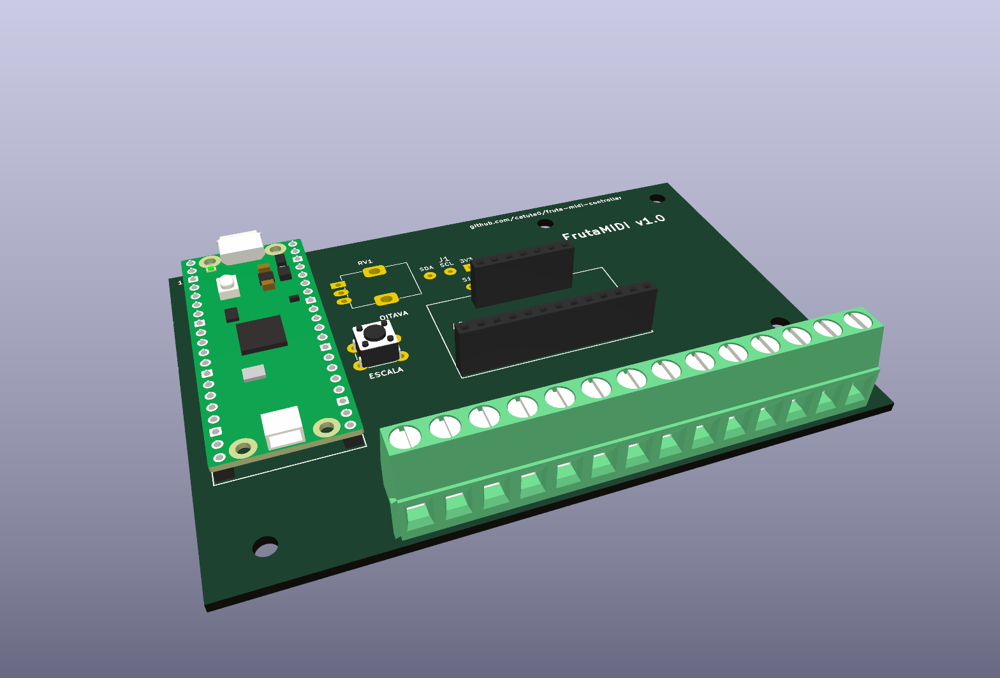
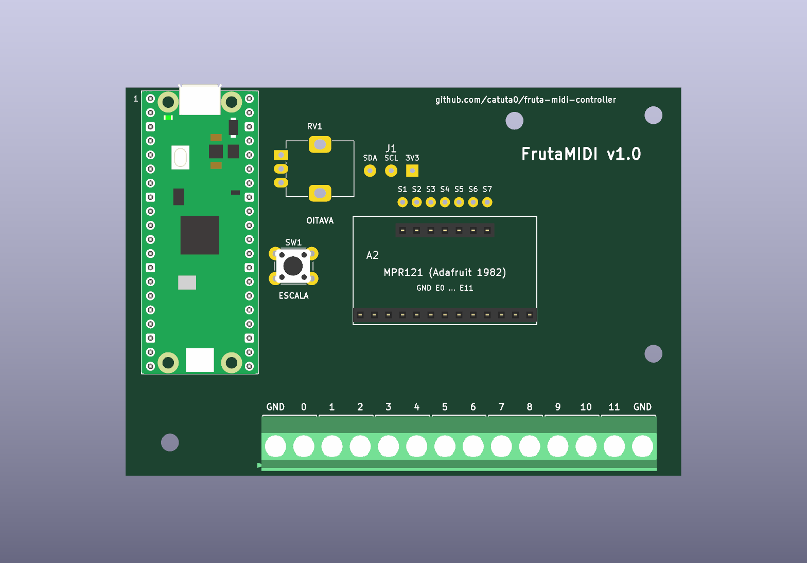

# FrutaMIDI — PCB de uma face (versão 1.0)

Placa de 100 × 70 mm, só com cobre na face de baixo e pensada para gravação química em casa (transferência de toner ou placa fotossensível). Leva um Raspberry Pi Pico e um módulo Adafruit MPR121 (1982), ambos em socket, mais 14 terminais de parafuso, um botão e um potenciómetro.



> **Estado:** o esquemático passa o ERC e a PCB passa o DRC, ambos sem violações, e a PCB corresponde ao esquemático. A placa ainda não foi fabricada nem testada fisicamente. Se fizeres uma, abre uma *issue* com o resultado.

## Conteúdo

- [Ficheiros](#ficheiros)
- [Lista de material](#lista-de-material)
- [Regras de desenho para gravação caseira](#regras-de-desenho-para-gravação-caseira)
- [1. Imprimir](#1-imprimir)
- [2. Transferir e gravar](#2-transferir-e-gravar)
- [3. Furar](#3-furar)
- [4. Soldar](#4-soldar)
- [5. Fios de configuração do módulo](#5-fios-de-configuração-do-módulo)
- [6. Testar antes de ligar](#6-testar-antes-de-ligar)
- [7. Firmware e primeiro arranque](#7-firmware-e-primeiro-arranque)
- [Problemas comuns](#problemas-comuns)
- [Modificar a placa](#modificar-a-placa)

## Ficheiros

| Ficheiro | Para quê |
| --- | --- |
| [`fabrico/1-cobre-para-transferir.pdf`](fabrico/1-cobre-para-transferir.pdf) | **O que imprimes** para toner ou placa fotossensível positiva. Escala 1:1, já na orientação certa |
| [`fabrico/1b-cobre-negativo.pdf`](fabrico/1b-cobre-negativo.pdf) | O mesmo em negativo, só para filme seco / resina negativa |
| [`fabrico/2-mapa-de-montagem.pdf`](fabrico/2-mapa-de-montagem.pdf) | Onde vai cada componente, visto de cima |
| [`fabrico/3-serigrafia-opcional-espelhada.pdf`](fabrico/3-serigrafia-opcional-espelhada.pdf) | Opcional: transferir as legendas para o lado dos componentes |
| [`fabrico/frutamidi-esquematico.pdf`](fabrico/frutamidi-esquematico.pdf) | Esquemático |
| [`fabrico/gerbers/`](fabrico/gerbers/) | Gerbers + furação Excellon, se preferires encomendar a placa (JLCPCB, PCBWay…) |
| [`fabrico/bom-kicad.csv`](fabrico/bom-kicad.csv) | BOM exportada do KiCad |
| `frutamidi.kicad_pro` / `.kicad_sch` / `.kicad_pcb` | Projeto KiCad 10, com bibliotecas próprias (`FrutaMIDI.kicad_sym`, `FrutaMIDI.pretty/`) |
| [`scripts/`](scripts/) | Geradores do esquemático e da PCB, e `build_all.sh` (regenera, verifica e exporta) |

## Lista de material

### Componentes

| Ref. | Peça | Qtd | Preço aprox. | Notas |
| --- | --- | --- | --- | --- |
| A1 | Raspberry Pi Pico **H** (ou Pico, Pico W, Pico 2, Pico 2 W com barras macho soldadas) | 1 | 5–8 € | O "H" já traz os pinos |
| A2 | Adafruit MPR121 12-key capacitive touch breakout (**produto 1982**) | 1 | 9–12 € | Original ou STEMMA QT: ambas servem (ver [secção 5](#5-fios-de-configuração-do-módulo)). Traz a barra macho para soldar ao módulo |
| — | Barra fêmea 1×20, passo 2,54 mm | 2 | 1 € | Socket do Pico |
| — | Barra fêmea 1×13, passo 2,54 mm | 1 | 0,50 € | Fila dos elétrodos do módulo |
| — | Barra fêmea 1×7, passo 2,54 mm | 1 | 0,40 € | Fila de alimentação/I²C do módulo |
| J2 | Bloco de terminais de parafuso 2 vias, passo **5,08 mm**, encaixável (KF301-2P, Phoenix MKDS 1,5/2-5,08 ou equivalente) | 7 | 2–3 € | Encaixam uns nos outros e formam a régua de 14 |
| SW1 | Botão de pressão 6 × 6 mm, 4 pernas | 1 | 0,20 € | Escolhe a altura conforme a caixa |
| RV1 | Potenciómetro 10 kΩ linear (B10K), 9 mm, vertical, tipo Alps RK09K | 1 | 1 € | Mais um botão rotativo |
| — | Fio rígido isolado fino (de cabo de rede, por ex.) | ~10 cm | — | 3 fios de configuração |
| H1–H4 | Parafusos M3 + espaçadores | 4 | 2 € | Opcional |
| — | Cabo micro-USB **de dados** | 1 | 3 € | |

Se usares barra fêmea de 40 vias para cortar, perdes um pino em cada corte: 3 barras de 1×40 chegam à justa para 20 + 20 + 13 + 7.

### Material de fabrico

| Peça | Qtd | Notas |
| --- | --- | --- |
| Placa de cobre de **uma face**, FR4 ou FR2, 100 × 70 mm (35 µm) | 1 | Ou corta de uma maior |
| **Toner:** impressora laser + papel de transferência (ou papel de revista brilhante) + ferro de engomar | — | A tinta de jato de tinta não serve |
| **Fotográfico:** placa pré-sensibilizada positiva + acetato + lâmpada UV + revelador (hidróxido de sódio) | — | Em alternativa ao toner |
| Percloreto de ferro (ou persulfato de sódio) | ~0,5 L | Ver segurança na secção 2 |
| Recipiente de plástico, luvas de nitrilo, óculos | — | Nada de metal |
| Acetona ou diluente, palha de aço fina, álcool isopropílico | — | Limpeza |
| Marcador permanente fino | 1 | Retocar falhas de toner |
| Brocas de 0,9 · 1,0 · 1,1 · 1,3 · 2,0 · 3,2 mm | 1 cada | Mini-berbequim, de preferência em suporte |
| Ferro de soldar, solda com fluxo (0,8 mm), multímetro | — | |

## Regras de desenho para gravação caseira

| Regra | Valor |
| --- | --- |
| Faces de cobre | Só a de baixo; componentes todos de furo passante em cima |
| Largura das pistas | 1,0 mm (sinais) e 1,2 mm (GND, 3V3); 0,8 mm nas ligações curtas da fila S |
| Isolamento mínimo | 0,6 mm (regra do projeto); 0,5 mm é o mínimo absoluto aceite no DRC |
| Pads | Ovais de 2,4 × 1,6 mm nas barras de 2,54 mm (0,94 mm entre pads), 3,0 mm nos terminais |
| Vias e pontes | Nenhumas. Só os 3 fios de configuração do módulo |
| Plano de massa | Não tem, de propósito: cobre à volta das pistas dos elétrodos rouba sensibilidade |

## 1. Imprimir

1. Abre [`1-cobre-para-transferir.pdf`](fabrico/1-cobre-para-transferir.pdf) e imprime em **tamanho real / 100 %**, sem "ajustar à página".
2. Mede o contorno impresso: tem de dar **100 × 70 mm**. Se não der, a escala da impressora está errada.
3. Confirma que o texto **"FrutaMIDI v1.0" aparece ao contrário (em espelho) no papel**. É assim mesmo: ao passar para o cobre fica direito.
4. Para toner: impressora laser, densidade máxima, papel de transferência. Para fotossensível: acetato, e de preferência duas cópias sobrepostas, para ficar bem opaco.

Os pontos pequenos no centro dos pads ficam sem cobre depois de gravar e servem de guia para a broca.

## 2. Transferir e gravar

**Preparar a placa:** corta-a a 100 × 70 mm e lixa o cobre com palha de aço até ficar brilhante. Limpa com álcool e não lhe toques mais com os dedos.

**Toner**

1. Põe o papel com a tinta virada para o cobre e prende-o com fita-cola.
2. Ferro no máximo, sem vapor, 3–5 minutos com pressão, passando bem pelos cantos.
3. Deixa arrefecer, mergulha em água morna 5–10 minutos e tira o papel a esfregar com o dedo.
4. Retoca com marcador permanente as pistas falhadas ou os pads com buracos.

**Fotossensível positiva**

1. Põe o acetato com a tinta virada para a resina (fica mais nítido).
2. Expõe à luz UV conforme o fabricante (normalmente 1–3 minutos), revela, passa por água e confirma que as pistas ficaram nítidas.

**Corroer**

- Percloreto de ferro a 40–50 °C (banho-maria), a agitar: 10–20 minutos. Tira a placa quando o cobre entre as pistas tiver desaparecido todo.
- Lava com água, tira o toner/resina com acetona, e confirma contra a luz que não há pontes entre pistas, sobretudo no leque dos elétrodos e entre os pads do Pico.

**Segurança:** usa luvas e óculos, num sítio ventilado. O percloreto mancha tudo de forma permanente e é corrosivo. Não deites a solução usada no esgoto: tem cobre dissolvido, por isso leva-a a um ecocentro. Se usares ácido clorídrico com água oxigenada, mistura sempre em pequenas quantidades e ao ar livre, porque liberta gases tóxicos.

## 3. Furar

Fura do lado do cobre, a usar os pontos como guia. São 97 furos ao todo.

| Broca | Furos | Onde |
| --- | --- | --- |
| 0,9 mm | 10 | Fila S1–S7 e J1 (fios de configuração) |
| 1,0 mm | 63 | Barras fêmea do Pico (40) e do módulo (20), pinos do potenciómetro (3) |
| 1,1 mm | 4 | Botão |
| 1,3 mm | 14 | Terminais de parafuso |
| 2,0 mm | 2 | Patilhas do potenciómetro (no desenho são ranhuras de 2,1 × 1,8 mm) |
| 3,2 mm | 4 | Fixação M3 (opcional) |

Se quiseres, passa fluxo ou verniz de proteção no cobre depois de furar. Também podes estanhar as pistas com o ferro, para não oxidarem.

## 4. Soldar

Solda do componente mais baixo para o mais alto, para a placa assentar direita na mesa. Usa o [mapa de montagem](fabrico/2-mapa-de-montagem.pdf).



1. **Botão SW1** ("ESCALA").
2. **Barras fêmea do Pico (2 × 1×20).** Truque: encaixa as duas barras no Pico, pousa o conjunto na placa e solda. Ficam paralelas e com a distância certa. Depois tira o Pico.
3. **Barras fêmea do módulo (1×13 e 1×7).** Mesmo truque: solda primeiro a barra macho ao módulo, encaixa as fêmea, pousa na placa e solda.
4. **Potenciómetro RV1** ("OITAVA"), incluindo as duas patilhas.
5. **Terminais J2.** Encaixa os 7 blocos uns nos outros antes de os pôr na placa, com as entradas dos fios viradas para fora da placa.
6. **Os 3 fios de configuração:** ver a secção seguinte.

## 5. Fios de configuração do módulo

O Adafruit 1982 existe em duas versões, com os 7 pinos de alimentação/I²C por ordem diferente. Por isso a placa não os liga diretamente: tem 3 furos com sinal (**J1: SDA, SCL, 3V3**) e 7 furos **S1–S7**, cada um mesmo por cima de um pino do módulo. Ligas três fios conforme o teu módulo.

**Regra simples:** lê as letras impressas no módulo junto à fila de 7 pinos, e liga:
- J1 **3V3** → o furo por cima do pino **VIN** (versão original) ou **VCC** (versão STEMMA QT);
- J1 **SDA** → o furo por cima do pino **SDA**;
- J1 **SCL** → o furo por cima do pino **SCL**.

Para confirmar:

| Versão | Como a reconheces | 3V3 → | SDA → | SCL → |
| --- | --- | --- | --- | --- |
| Original | Sem conectores brancos pequenos | **S1** | **S5** | **S6** |
| STEMMA QT (atual) | Dois conectores brancos de 4 pinos (STEMMA QT / Qwiic) | **S7** | **S3** | **S4** |

Usa fio rígido isolado e passa-o pelo lado dos componentes. Solda os três fios por baixo, no cobre. Os outros 4 furos S ficam vazios. O GND do módulo não precisa de fio: entra pela fila dos elétrodos e é igual nas duas versões.

> Se trocares os fios, o mais provável é o sensor não responder e o LED do Pico piscar depressa. Não ligues o 3V3 a outro furo que não o VIN/VCC: num deles está o GND do módulo, e isso faz curto-circuito.

## 6. Testar antes de ligar

Com o multímetro em modo de continuidade, **sem o Pico e sem o módulo encaixados**:

- [ ] Entre o furo **3V3** de J1 e um terminal **GND**: **não** pode apitar.
- [ ] Entre cada terminal 0…11 e o pino correspondente da barra 1×13 do módulo: apita.
- [ ] Entre terminais vizinhos (0–1, 1–2, …): **não** apita.
- [ ] Entre os dois terminais GND das pontas: apita.
- [ ] Entre o pino SDA do módulo e o pino 31 do socket do Pico (e SCL e o pino 32): apita, já com os fios de configuração soldados.

## 7. Firmware e primeiro arranque

A placa usa pinos diferentes dos da breadboard, por isso precisa da **versão PCB** do firmware:

| Placa | Ficheiro (nos [Releases](https://github.com/catuta0/fruta-midi-controller/releases/latest)) |
| --- | --- |
| Raspberry Pi Pico | `FrutaMIDI-pcb-rpipico.uf2` |
| Raspberry Pi Pico W | `FrutaMIDI-pcb-rpipicow.uf2` |
| Raspberry Pi Pico 2 | `FrutaMIDI-pcb-rpipico2.uf2` |
| Raspberry Pi Pico 2 W | `FrutaMIDI-pcb-rpipico2w.uf2` |

1. Com o Pico **fora da placa**, segura o BOOTSEL, liga o USB e arrasta o `.uf2` para a drive RPI-RP2 (no Pico 2: RP2350).
2. Desliga o USB. Encaixa o Pico com o **USB virado para a borda de cima** (o "1" da serigrafia fica junto ao pino 1).
3. Encaixa o módulo com a **fila de 13 pinos virada para os terminais**: as letras do módulo ficam de pernas para o ar, e é assim mesmo.
4. Liga o USB. O LED do Pico deve dar 2 piscadelas lentas (sensor encontrado) e depois acender sempre que tocas num terminal.
5. Abre o [sampler online](https://catuta0.github.io/fruta-midi-controller/), toca com o dedo no parafuso do terminal 0 e deve tocar o bombo.

Se compilares tu, descomenta `#define FRUTAMIDI_PCB` no início de [`FrutaMIDI.ino`](../firmware/FrutaMIDI/FrutaMIDI.ino). Esta definição muda o I²C para GP26/GP27 (`Wire1`), o botão para GP22 e o potenciómetro para GP28, e liga o potenciómetro.

| Sinal | Pino do Pico | GP |
| --- | --- | --- |
| SDA (I²C1) | 31 | GP26 |
| SCL (I²C1) | 32 | GP27 |
| Botão | 29 | GP22 |
| Potenciómetro | 34 | GP28 / ADC2 |
| 3V3 | 36 | — |
| AGND | 33 | — |
| GND | 3, 8, 13, 18, 23, 28, 38 | — |

## Problemas comuns

| Sintoma | Causa provável | O que fazer |
| --- | --- | --- |
| LED do Pico pisca depressa | Sensor não responde | Confirma os 3 fios de configuração para a tua versão; confirma que carregaste o `.uf2` **pcb** |
| Nada acontece ao ligar | Pico ao contrário ou cabo só de carga | USB para a borda de cima; troca de cabo |
| Um terminal está sempre a tocar | Ponte de cobre ou de solda entre pistas | Procura com lupa no leque dos elétrodos; corta com x-ato |
| Dois terminais tocam juntos | Curto entre pistas vizinhas | Mesmo procedimento |
| O potenciómetro não muda a oitava | Firmware de breadboard | Carrega o `.uf2` **pcb** |
| A oitava salta sozinha | Patilha ou pino do potenciómetro mal soldado | Ressolda RV1 |

Os problemas de sensibilidade (fruta, cabos, terra) são os mesmos da breadboard: ver as [notas de design no README principal](../README.md#notas-de-design).

## Modificar a placa

O esquemático e a PCB são gerados pelos scripts em [`scripts/`](scripts/), não desenhados à mão. Para mudar alguma coisa, edita `gen_schematic.py` / `gen_pcb.py` e corre:

```sh
sh hardware/scripts/build_all.sh
```

O script regenera tudo, corre o ERC e o DRC (falha se houver violações), confirma que a PCB corresponde ao esquemático e volta a exportar a pasta `fabrico/`. Os ficheiros KiCad também abrem e editam normalmente no KiCad 10, mas se os editares à mão deixa de os regenerar com o script.

O desenho do módulo foi medido nos [ficheiros Eagle da Adafruit](https://github.com/adafruit/Adafruit-MPR121-PCB) (CC BY-SA). As duas versões têm a mesma geometria: só muda a ordem da fila de 7 pinos.
