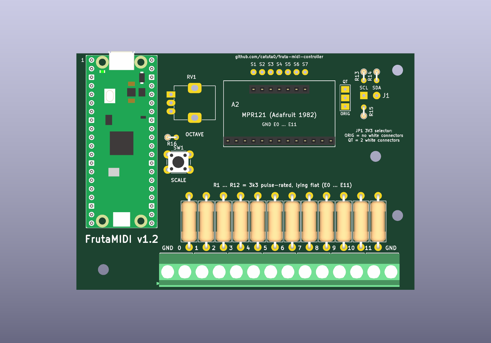

# FrutaMIDI: single-sided SMD PCB (version 1.3)

A 100 × 70 mm board with copper on the **component side only**, designed for chemical etching at home (toner transfer or photosensitive board). Everything is surface-mounted, so the only holes are the 4 M3 mounting holes. The board carries a Raspberry Pi Pico soldered on its castellations, an Adafruit MPR121 module (1982) standing on its header pins, 14 solder-wire pads for the electrodes and GND, a button, three wire pads for an off-board potentiometer, a 3.3 kΩ series resistor on each electrode, two I²C pull-up resistors and two 220 Ω I²C series resistors.



> **Status:** the schematic passes ERC and the PCB passes DRC, both with no violations, and the PCB matches the schematic. <!-- EVIDENCE --> The board has not been fabricated, soldered or tested. Hand-soldering the Pico and the module header joints has not been tried. ERC and DRC passing does not validate the hardware. If you make one, open an *issue* with the result.

## Contents

- [Files](#files)
- [Bill of materials](#bill-of-materials)
- [Design rules for home etching](#design-rules-for-home-etching)
- [1. Print](#1-print)
- [2. Transfer and etch](#2-transfer-and-etch)
- [3. Drill](#3-drill)
- [4. Solder](#4-solder)
- [5. Module configuration: JP1 and two wires](#5-module-configuration-jp1-and-two-wires)
- [6. Test before soldering the Pico and the module](#6-test-before-soldering-the-pico-and-the-module)
- [7. Firmware and first power-up](#7-firmware-and-first-power-up)
- [Common problems](#common-problems)
- [Electrical safety](#electrical-safety)
- [Modifying the board](#modifying-the-board)

## Files

| File | Purpose |
| --- | --- |
| [`fabrication/1-copper-for-transfer.pdf`](fabrication/1-copper-for-transfer.pdf) | **What you print** for toner or positive photosensitive board. 1:1 scale, already mirrored for transfer onto the component-side copper |
| [`fabrication/1b-copper-negative.pdf`](fabrication/1b-copper-negative.pdf) | The same in negative, only for dry film / negative resist |
| [`fabrication/2-assembly-map.pdf`](fabrication/2-assembly-map.pdf) | Where each component goes, with references and pin 1. There is no silkscreen on the board: keep this page at the bench |
| [`fabrication/frutamidi-schematic.pdf`](fabrication/frutamidi-schematic.pdf) | Schematic |
| [`fabrication/gerbers/`](fabrication/gerbers/) | Gerbers + Excellon drill files, if you prefer to order the board |
| [`fabrication/bom-kicad.csv`](fabrication/bom-kicad.csv) | BOM exported from KiCad, with manufacturer, part number and Mouser number columns |
| `frutamidi.kicad_pro` / `.kicad_sch` / `.kicad_pcb` | KiCad 10 project, with its own libraries (`FrutaMIDI.kicad_sym`, `FrutaMIDI.pretty/`) |
| [`scripts/`](scripts/) | Schematic and PCB generators, and `build_all.sh` (regenerates, checks and exports) |

## Bill of materials

### Components

All parts below are sold by Mouser. One board costs about 13.84 EUR at Mouser Portugal prices of 2026-11-11 (12 resistors at the 10+ price, everything else at the single-unit price), excluding shipping and tax.

| Ref. | Part | Qty | Notes |
| --- | --- | --- | --- |
| A1 | Raspberry Pi Pico, Raspberry Pi **SC0915** (Mouser 358-SC0915). The **Pico 2** also fits; the USB receptacle face 1.30 mm beyond the Pico end (SOURCE, Pico drawing), 1.19 mm beyond the board edge (CALCULATION, design file), is taken from the Pico drawing, not from a Pico 2 drawing, so do the plug-seat check of section 4 step 5 with your Pico 2 before soldering it. **Pico W and Pico 2 W are not supported on this board** until their underside has been checked against the keep-outs. The castellated pads must be free, so **no** H version with headers fitted | 1 | Surface-soldered on its castellated edge pads. There are no sockets: a failed Pico must be desoldered from the surface. The keep-outs under it cover the test points and USB pads of both the Pico and the Pico 2, including the Pico 2's TP7 (1.1 V core supply) |
| A2 | Adafruit MPR121 12-key capacitive touch breakout, Adafruit **1982** (Mouser 485-1982) | 1 | Original or STEMMA QT: both work (section 5). Use the male headers supplied with it |
| R1–R12 | Thick-film chip resistor 3.3 kΩ ±1 %, 1 W, 2512, YAGEO **RC2512FK-073K3L** (Mouser 603-RC2512FK-073K3L) | 12 | One in series with each electrode. **Stock is tight:** Mouser showed 13 in stock on 2026-11-11, next delivery May 2027. Any 3.3 kΩ ±1 % 2512 chip with a body 6.35 × 3.1 mm fits the same pads. **Alternative in stock:** Vishay **CRCW25123K30FKEG** (Mouser 71-CRCW25123K30FKEG, 3.3 kΩ 1 %, 2512): Mouser showed 4,500 in stock on 2026-11-11, 0.424 EUR each at 10+ (about 5.09 EUR for 12, against 1.31 EUR for the YAGEO part). Its datasheet has not been checked for this board: confirm that the body is the standard 6.35 × 3.1 mm 2512 size before ordering. Neither part has a published surge rating, see [Electrical safety](#electrical-safety) |
| R13, R14 | Resistor 4.7 kΩ 1 %, 1206, YAGEO **RC1206FR-074K7L** (Mouser 603-RC1206FR-074K7L) | 2 | I²C pull-ups (SCL, SDA) |
| R15, R16 | Resistor 220 Ω 1 %, 1206, YAGEO **RC1206FR-07220RL** (Mouser 603-RC1206FR-07220RL) | 2 | In series in SCL (R15) and SDA (R16), on the Pico side; they limit the current if a configuration wire goes to the wrong pad |
| C1 | Ceramic capacitor 100 nF 50 V X7R, 1206, Samsung **CL31B104KBCNNNC** (Mouser 187-CL31B104KBCNNNC) | 1 | Potentiometer wiper to AGND, near the Pico |
| SW1 | Tactile switch **B3S-1000** (6 × 6 mm, SMD, height 4.3 mm; Mouser 653-B3S-1000) | 1 | Mouser lists the maker as **Aratas**; its maker page says "ARATAS, formerly Omron Components", so this is the genuine Omron B3S-1000 (checked 2026-11-11) |
| RV1 | 10 kΩ linear potentiometer, Bourns **PTV09A-4015F-B103** (Mouser 652-PTV09A-4015FB103; 9 mm, insulated flatted shaft 6 mm, 15 mm long, no bushing, PC pins), off-board, connected by 3 wires | 1 | It has no threaded bushing, so it cannot be bolted through a panel. **Mounting:** solder its pins into a small piece of perfboard (about 20 × 15 mm) and solder the 3 wires to those pins on the perfboard; drill a 7 mm hole in the enclosure for the shaft, put the shaft through it from inside and fix the perfboard behind the panel with hot-melt or epoxy at its edges (or two small screws through the perfboard), keeping glue off the shaft and out of the pot. Gluing the pot body directly behind the hole also works, but the perfboard takes the turning force off the pins. See [Electrical safety](#electrical-safety): keep the insulated shaft and use a plastic knob. If the octave goes down when you turn clockwise, swap the two outer wires |
| — | Knob for RV1, Same Sky **SPK-016A** (Mouser 179-SPK-016A; ABS, 11 mm, for 6 mm shafts) | 1 | Whether its bore grips the flatted shaft is not confirmed; check the fit, or use any plastic knob for a 6 mm flatted (D) shaft |
| J1, J2, J3, JP1 | Etched copper pads only (no part): J1 configuration-wire pads, J2 electrode wire pads, J3 S1–S7 pads, JP1 solder bridge | — | Not in `bom-kicad.csv`. JP1 is bridged with a short tinned wire off-cut, see section 5. The RV1 knob is also not in `bom-kicad.csv` (it has no schematic symbol); this table is the full list |
| — | Thin insulated solid wire (from network cable, for example) | ~10 cm | The 2 configuration wires (SDA, SCL) |
| — | Electrode wire, insulated, 0.25–0.5 mm² | 12 + GND | Soldered to the J2 pads, then strain-relieved with hot-melt glue |
| — | Hot-melt glue, 2-part epoxy | — | Hot-melt on each J2 wire and RV1 wire; epoxy side beads at Pico pins 1-3 and 38-40 |
| H1–H4 | M3 screws + spacers, **nylon** preferred | 4 | Optional; see the mounting note in section 4. Nylon keeps loose metal away from the electrode resistors |
| — | Micro-USB **data** cable, strain-relieved or supported | 1 | The USB connector is held only by the castellation solder joints and the epoxy bead. Do not lever on the plug |

### Fabrication materials

| Part | Qty | Notes |
| --- | --- | --- |
| **Single-sided** copper board, FR4 or FR2, 100 × 70 mm (35 µm) | 1 | Or cut from a larger one |
| **Toner:** laser printer + transfer paper (or glossy magazine paper) + clothes iron | — | Inkjet ink does not work |
| **Photographic:** positive pre-sensitised board + transparency film + UV lamp + developer (sodium hydroxide) | — | Alternative to toner |
| Ferric chloride (or sodium persulfate) | ~0.5 L | See the safety note in section 2 |
| Plastic container, nitrile gloves, goggles | — | Nothing metal |
| Acetone or thinner, fine steel wool, isopropyl alcohol | — | Cleaning |
| Fine permanent marker | 1 | Touching up toner gaps |
| Drill bit of **3.2 mm** | 1 | For the 4 mounting holes, which are the only holes on the board |
| Soldering iron with a fine chisel tip, flux, flux-core solder (0.5–0.8 mm), tweezers, multimeter, polyimide tape (optional) | — | |

## Design rules for home etching

| Rule | Value |
| --- | --- |
| Copper layers | One layer, on the component side (top). SMD only |
| Holes | Only the 4 M3 mounting holes (not plated) |
| Track width | 1.0 mm (signals) and 1.2 mm (GND, 3V3); 0.8 mm on the short S2–S6 stubs, which lie entirely inside the S-row pads and the S pads, so no 0.8 mm track is exposed on the etched board |
| Minimum clearance | 0.6 mm (project rule); 0.5 mm is the absolute minimum accepted by DRC |
| Vias and bridges | No vias, no copper pour. Only the JP1 solder bridge and the 2 module configuration wires |
| Pads | Pico 1.6 × 4.2 mm (all 40 etched, 0.94 mm gap), module 1.8 × 4.2 mm (13-pin row) and 1.8 × 5.5 mm (7-pin row, joined to the S1–S7 pads), 0.74 mm gap, J2 3.0 × 4.5 mm, RV1 3.0 mm, JP1 1.94 × 2.4 mm on a 3.81 mm pitch (1.87 mm between pads), 1206 parts 1.8 × 1.8–1.9 mm. Every hand-soldered pad reaches at least 1.0 mm beyond the part body (or the module outline), so the iron touches the pad outside the part |
| Keep-out under the Pico | No bare copper under the Pico's exposed test points and USB shell pads, nor under its 3 SWD pads: TP6 is BOOTSEL, so a short there means a Pico that always boots to mass storage |
| Ground plane | None, on purpose: copper around the electrode tracks takes away sensitivity |

## 1. Print

1. Open [`1-copper-for-transfer.pdf`](fabrication/1-copper-for-transfer.pdf) and print at **actual size / 100 %**, without "fit to page".
2. Measure the printed outline: it must be **100 × 70 mm**. If it is not, the printer scale is wrong.
3. Check that the text **"FrutaMIDI v1.3" appears reversed (mirrored) on the paper**, and that the Pico pads appear on the **right** of the page. That is intended: transferred onto the copper, the text reads correctly when you look at the copper with the components on it.
4. For toner: laser printer, maximum density, transfer paper. For photosensitive board: transparency film, preferably two copies stacked so it is fully opaque.

## 2. Transfer and etch

**Preparing the board:** cut the blank **oversize**, about 110 × 80 mm, and rub the copper with steel wool until it shines. The outline is printed with the tracks and etched as a thin copper line: after etching (and before soldering), trim the board to the **outside of that etched line** with a saw or shears and file the edges. The Pico's USB end lies on the top edge, with its connector sticking out about 1.2 mm, so do not cut inside the line at that edge. Clean it with alcohol and do not touch it with your fingers again.

**Toner**

1. Place the paper with the ink facing the copper and hold it with tape.
2. Iron on maximum, no steam, 3–5 minutes with pressure, going well over the corners.
3. Let it cool, soak in warm water for 5–10 minutes and remove the paper by rubbing with your finger.
4. Touch up broken tracks or pads with holes using the permanent marker.

**Positive photosensitive**

1. Place the transparency with the ink facing the resist.
2. Expose to UV light as the manufacturer specifies (usually 1–3 minutes), develop, rinse in water and check that the tracks are sharp.

**Etching**

- Ferric chloride at 40–50 °C (water bath), agitating: 10–20 minutes. Take the board out when all the copper between the tracks has gone.
- Rinse with water, remove the toner/resist with acetone, and check against the light that there are no bridges between tracks, especially between the Pico pads, in the electrode fan-out and at JP1.
- **Keep the 1.4 mm gap between each electrode pad and the GND track along the bottom edge clean and open:** it is an intentional spark gap (see [Electrical safety](#electrical-safety)).

**Safety:** wear gloves and goggles, in a ventilated place. Ferric chloride stains everything permanently and is corrosive. Do not pour the used solution down the drain: it contains dissolved copper, so take it to a recycling/waste collection centre. If you use hydrochloric acid with hydrogen peroxide, always mix it in small quantities and outdoors, because it releases toxic gases.

## 3. Drill

Drill only the 4 mounting holes, **3.2 mm**, at H1–H4 (see the assembly map). They are optional: without them the board can be fixed with adhesive feet. There are no other holes.

If you like, tin the bare copper with the iron or apply protective lacquer after etching, but keep lacquer off every pad you are going to solder.

## 4. Solder

Use the [assembly map](fabrication/2-assembly-map.pdf). Work from the lowest parts to the tallest. **Clean flux from around R1–R12 afterwards with isopropyl alcohol:** residue on the bare FR-4 between the two ends of each resistor shortens the surface path that the 4 kV estimate relies on.

1. **R13–R16 (1206) and C1 (1206).** Tin one pad, place the part with tweezers, solder that end, then the other. C1 is not polarised.
2. **R1–R12 (2512, 3.3 kΩ).** One per electrode, in one row between the module and J2. Keep solder off the 5.0 mm gap between the two pads and do not let any wire or solder cross it.
3. **Button SW1** (B3S-1000). Align all four legs on their pads and solder them all.
4. **[Run section 6 now](#6-test-before-soldering-the-pico-and-the-module)**, before the Pico and the module go on. After that you cannot get under them.
5. **Pico (A1).** Flash the firmware first, while the Pico is still loose (section 7). Check that no bare copper shows under the test-point areas marked on the assembly map. Lay the Pico on its pads with the USB end at the top edge of the board: the end of the Pico is 0.1 mm inside the board edge and the USB connector sticks out about 1.2 mm beyond it. **Before soldering, plug the cable in** with the Pico held in place: the plug must go fully home without touching the board edge; if it does not, file the board edge back to the etched outline. Press the Pico down at each corner: it must **not rock**. Solder left at the USB connector pins on the Pico's underside can hold it up; if it rocks, remove that solder with braid first. Then align the castellations over the pads, hold the board flat, tack two opposite corner pads, check alignment, then solder all 40 pads from the outer edge of each castellation. All 40 are anchors, even those without a track.
6. **Epoxy side beads.** After soldering and after a first USB check that the Pico still starts (the fast LED blink without the module is expected), apply a small bead of 2-part epoxy along each **long side** of the Pico at the USB end: one over the joints of pins 1–3 (left side) and one over pins 38–40 (right side), joining the Pico's edge to the board. Keep epoxy **off the USB end face** of the Pico and never let any go **beyond the board edge**: the end of the Pico is level with the board edge, so there is no board there to bond to, and that is where the plug's moulding has to seat. After the epoxy has cured, plug the cable in again and check that it still goes fully home. Use a strain-relieved cable: a sharp pull on the plug can peel the end pads.
7. **JP1** (section 5, step 1), **before the module goes on**: the ORIG label is etched where the module will cover it.
8. **Module (A2).** Fit the supplied male header to the module from below, short pins up through the module, with the plastic strip pushed **up against the underside** of the module, and solder the pins on the top of the module. Cut the long pins below the strip to **3.0 mm** (measure from the strip; cut all 20 to the same length, a strip of card 3 mm thick helps). Stand the module on its 20 pads (13-pin row towards J2, as on the assembly map): each pin stands near the inner end of its pad, and the pad runs about 1.7 mm out beyond the edge of the module. Solder each pin from **outside the module**: put the iron on the outer part of the pad, feed solder where the pad meets the pin, and check that a fillet climbs the pin. The module must sit level on both rows; tack one pin at each end of each row first. The 7-pin row stands further in under the module than the 13-pin row (2.54 mm inside the module edge against 1.27 mm), so its joints are only visible from a low angle: hold the iron and look in almost flat to the board, from the J1 / Pico side, and check each fillet with a light behind it. Then check with the meter from each S pad (S1–S7) to the top of its own pin on the module: it beeps; and to its neighbour's pin: it does not. The underside of the module ends up about 5.5 mm above the board (3.0 mm pin + 2.5 mm strip, not measured), which keeps its copper and vias well off the bare tracks; the top of the module board is about 7.1 mm above the copper, plus the parts on it (the 1.6 mm module thickness is assumed, not measured).
9. **The 2 configuration wires** (section 5, step 2).
10. **RV1 wires.** Three insulated wires to pads 1 (3V3), 2 (wiper), 3 (AGND) to your off-board pot. Add a small bead of hot-melt over the wires, on the pads, for strain relief. Keep the wires short.
11. **Electrode and GND wires (J2).** Strip about **3–4 mm** of each wire and tin it. Lay it on the upper half of its pad so that the wire leaves the pad **upwards, towards the resistors, away from the board edge**, and solder it there, leaving the part of the pad next to the board edge clean. A wire led out over the bottom edge would cross the spark gap: lead the wires sideways off the board only after the hot-melt, above the pads. Add a bead of hot-melt over the wire and the upper pad. **Keep the glue away from the 1.4 mm gap at the bottom of the pad:** the spark gap must stay open air.

**Optional: silicone over R1–R12.** It is not needed to meet the 3.5 mm gap rule, which the resistor terminations already meet. If you want an extra cover against dust and moisture, apply it only after cleaning and after the tests in section 6, as one continuous bead without bubbles or voids over each resistor and its two pads. Use only a **neutral-cure, electronics-grade** silicone, never an acetic-cure (vinegar-smelling) bathroom silicone, which corrodes copper and solder. No particular product has been checked for this board.

**Mounting (M3).** The four holes are at H1 (5.0, 65.0), H2 (96.0, 4.0), H3 (96.5, 58.0) and H4 (29.8, 4.0) mm from the top-left board corner, as seen on the assembly map; the outer circle drawn around each hole is the 7 mm area kept free of copper. H4 is the screw closest to the USB end of the Pico: fit it if you fit any, because it stops the board bending when a cable is pulled. It does not make the Pico solder joints stronger, so the epoxy beads and a strain-relieved cable stay necessary.

Use M3 screws no wider than 5.6 mm under the head, with a washer of at most 7 mm. **Nylon screw and nylon washer preferred**, above all at H3, which is nearest the electrode resistors (and at H4, where a 7 mm metal washer would be only 0.6 mm from the Pico pads and the 3V3 track). If you use metal hardware, check after tightening that no washer touches copper or a part.

**Rework:** the Pico is soldered flat on its castellations and the module stands on its header pins, both on surface pads, so a failed one has to be desoldered from the board surface (there are no sockets). Use plenty of flux and hot air or a wide iron tip on one side at a time; cut through the epoxy beads at the Pico first.

## 5. Module configuration: JP1 and two wires

The Adafruit 1982 exists in two versions, with the 7 power/I²C pins in a different order. That is why the board does not connect them directly. Above the 7 module pins there are 7 surface pads **S1–S7** (J3), each one directly above a module pin. You configure the board for your module in two steps.

**Step 1: power (JP1), done before the module is fitted (section 4, step 7).** JP1 is a 3-pad solder bridge standing upright to the right of the module. Go by the **pad position**: the **bottom** pad (pad 1, where the S1 track comes in from the left) is **ORIG**, the **top** pad (pad 3, where the S7 track comes in) is **QT**, and the centre pad is 3V3. QT is etched above the top pad. ORIG is etched to the left of JP1, but almost all of it lies under the module outline, so it is hidden once the module is fitted. Bridge it to **one** side with a short tinned wire off-cut soldered flat across the two pads, or with solder. The pads are 3.81 mm apart (1.87 mm of bare board between them), so that a single blob cannot easily join all three; a solder-only bridge needs generous solder, the wire off-cut is easier:

- **ORIG** (pad 1 → S1): original version, 3V3 goes to **VIN**.
- **QT** (pad 3 → S7): STEMMA QT version, 3V3 goes to **VCC**.

**Step 2: I²C (two wires).** J1 (right of JP1) has 2 surface pads, **SCL on the left and SDA on the right**. Connect:

- J1 **SDA** → the S pad above the module's **SDA** pin;
- J1 **SCL** → the S pad above the module's **SCL** pin.

To confirm, read the letters printed on the module next to the 7-pin row, and check this table:

| Version | How to recognise it | JP1 | SDA → | SCL → |
| --- | --- | --- | --- | --- |
| Original | No small white connectors | **ORIG** | **S5** | **S6** |
| STEMMA QT (current) | Two small white 4-pin connectors (STEMMA QT / Qwiic) | **QT** | **S3** | **S4** |

Use insulated solid wire, run flat on the board and as short as the route allows (about 25–35 mm each). Solder each end flat on its surface pad, then add a small dab of hot-melt so the wire is not held by the joint alone. The module's GND needs no wire: it comes in through the electrode row and is the same in both versions.

> **A wrong JP1 position can damage the sensor.** ORIG on a STEMMA QT module puts 3V3 on the module's ADDR pin; QT on an original module puts it on IRQ. The MPR121 chip is then unpowered, so 3V3 on that pin is above its absolute maximum rating (VDD + 0.3 V), and it can back-feed the module through its 10 kΩ pull-ups. There is no direct short to GND, but the module is not supplied correctly, the sensor does not respond and the Pico LED blinks fast. Check JP1 against the table above **before** powering. Never bridge all three pads.

## 6. Test before soldering the Pico and the module

With the multimeter, after step 3 of section 4 and **before the Pico and the module go on**, because you cannot reach underneath them afterwards:

- [ ] Continuity between the **JP1 centre pad** (3V3) and a **GND** pad of J2: it must **not** beep.
- [ ] Resistance between each electrode pad of J2 and the matching pin pad of the 1×13 module row: about **3.3 kΩ** (3267–3333 Ω, plus your meter's error). It does not beep in continuity mode.
- [ ] Continuity between neighbouring J2 pads (0–1, 1–2, …): it does **not** beep.
- [ ] Continuity between the two GND pads at the ends of J2: it beeps.
- [ ] Resistance between the pads of pin 31 and pin 32 of the Pico footprint and the J1 SDA / SCL pads (through R16 / R15): about **220 Ω**.
- [ ] Inspect with a magnifier: no bridges between the Pico pads, no copper left in the keep-out areas marked on the assembly map.

Then the final checks, after the Pico and module are soldered and JP1 is bridged, with the USB still unplugged:

- [ ] Continuity between the JP1 centre pad and the S pad for your version (S1 for ORIG, S7 for QT): it beeps. The other side (S7 or S1) must **not** beep.
- [ ] Pico pads **36** (3V3), **39** (VSYS) and **40** (VBUS) to any GND pad (for example Pico pad 38): none of them may beep. Pads 39 and 40 have no track on this board; pad 39 lies 0.94 mm from the GND pad 38 (pad 40 is 3.48 mm from it), so a bridge from 39 to 38 shorts the supply. (Through the Pico's own circuit a meter may show a resistance or a diode drop between them; it must not show a short.)
- [ ] Pico pad **37** (3V3_EN) to pad **38** (GND): it must **not** beep. They are 0.94 mm apart; a bridge there switches the Pico's 3.3 V regulator off.
- [ ] The button pad next to the Pico (the upper left SW1 pad, BTN) to Pico pad **30** (RUN): it must **not** beep. Pad 30 is unused on this board but sits 1.07 mm from that button pad; a bridge there would reset the Pico when the button is pressed.

## 7. Firmware and first power-up

The board uses different pins from the breadboard, so it needs the **PCB version** of the firmware:

| Board | File (in [Releases](https://github.com/catuta0/fruta-midi-controller/releases/latest)) |
| --- | --- |
| Raspberry Pi Pico | `FrutaMIDI-pcb-rpipico.uf2` |
| Raspberry Pi Pico W (breadboard only: not supported on this PCB, see A1 in the parts list) | `FrutaMIDI-pcb-rpipicow.uf2` |
| Raspberry Pi Pico 2 | `FrutaMIDI-pcb-rpipico2.uf2` |
| Raspberry Pi Pico 2 W (breadboard only: not supported on this PCB, see A1 in the parts list) | `FrutaMIDI-pcb-rpipico2w.uf2` |

1. With the Pico **off the board**, hold BOOTSEL, plug in the USB and drag the `.uf2` onto the RPI-RP2 drive (on the Pico 2: RP2350).
2. Unplug the USB and solder the Pico, with its **USB end at the top edge** of the board and pin 1 as marked on the assembly map.
3. Solder the module with the **13-pin row facing J2**: the module's lettering ends up upside down, and that is intended.
4. Plug in the USB. The Pico LED should give 2 slow blinks (sensor found) and then light up whenever you touch an electrode wire.
5. Open the [online sampler](https://catuta0.github.io/fruta-midi-controller/), touch the wire on E0 with your finger and the kick drum should play.

Firmware can also be updated with the Pico soldered, because the BOOTSEL button is on the top of the Pico.

If you compile it yourself, uncomment `#define FRUTAMIDI_PCB` at the start of [`FrutaMIDI.ino`](../firmware/FrutaMIDI/FrutaMIDI.ino). This definition moves I²C to GP26/GP27 (`Wire1`), the button to GP22 and the potentiometer to GP28, and enables the potentiometer.

| Signal | Pico pin | GP |
| --- | --- | --- |
| SDA (I²C1) | 31 | GP26 |
| SCL (I²C1) | 32 | GP27 |
| Button | 29 | GP22 |
| Potentiometer | 34 | GP28 / ADC2 |
| 3V3 | 36 | — |
| AGND | 33 | — |
| GND | 3, 8, 13, 18, 23, 28, 38 | — |

## Common problems

| Symptom | Likely cause | What to do |
| --- | --- | --- |
| Pico LED blinks fast | Sensor not responding | Check that JP1 is bridged to the side for your version and that the 2 wires go to the right S pads; check that you uploaded the **pcb** `.uf2` |
| Nothing happens when plugged in, Pico in BOOTSEL mode all the time | Copper or solder touching the Pico's test points under the Pico | Inspect the keep-out under the Pico; you may need to desolder |
| Nothing happens when plugged in, the Pico LED never lights and no drive appears, even in BOOTSEL mode | Solder bridge from Pico pad 37 (3V3_EN) or 39 (VSYS) to pad 38 (GND) | Check 37–38 and 39–38 with the meter (section 6); remove the bridge with desoldering braid |
| Nothing happens when plugged in | Bad Pico castellation joint, or charge-only cable | Re-flow the Pico joints; change the cable |
| One electrode is always playing | Copper or solder bridge between tracks | Look with a magnifier in the electrode fan-out and the resistor row; cut with a craft knife |
| Two electrodes play together | Short between neighbouring tracks | Same procedure |
| One electrode never plays | Resistor of that electrode not soldered, or broken track | Measure about 3.3 kΩ from the wire to the module pad (section 6); re-solder |
| The potentiometer does not change the octave | Breadboard firmware, or a broken RV1 wire | Upload the **pcb** `.uf2`; check the three wires |
| The octave jumps by itself | RV1 wire badly soldered | Re-solder and strain-relieve the wires |

Sensitivity problems (fruit, cables, ground) are the same as on the breadboard: see the [design notes in the main README](../README.md#design-notes).

## Electrical safety

Each electrode has a 3.3 kΩ chip resistor (R1–R12) between the wire pad and the sensor. It limits the current into the sensor pin during an IEC 61000-4-2 contact discharge to about 1.1 A at ±4 kV, below the about 1.33 A inferred from the sensor's 2 kV HBM rating (the sensor pin's surge limit is inferred, not specified). That margin of about 1.2 compares peak currents only: the 4 kV IEC discharge through 3.3 kΩ carries about **3.0 times the charge** of the 2 kV HBM test (about 600 nC against 200 nC) and lasts about **3.6 times longer** (decay time about 0.54 µs against 0.15 µs), so the pin is stressed for longer than in the test its rating comes from, and the margin is weaker than the current ratio alone suggests. Whether the resistor itself survives is **not proven**: at 4 kV about 3.6 kV appears across it for under a microsecond, more than seven times its 500 V overload rating, and the maker publishes no surge rating for it. The energy is small (about 1 mJ per discharge) and the estimated heating is small, but local damage at the trim cut, a shift in resistance after repeated discharges, or an arc along the resistor cannot be excluded without a test. A spark could also try to jump around the resistor: its copper pads are 5.0 mm apart and its metal terminations at least 4.65 mm apart (from the datasheet dimensions), above the 3.5 mm estimated for 4 kV and below the 7.5 mm estimated for 8 kV. Each electrode pad is 1.40 mm from the GND track along the board edge, so a strong discharge will most likely jump to GND there instead of reaching the sensor; keep that gap open. That spark gap is also unproven. Only an ESD-gun test can confirm the protection. The board has not been evaluated for higher discharge levels or for touching while it is connected to mains-powered equipment. <!-- EVIDENCE --> See the [electronics analysis, section 8](../reports/electronics/analysis.md#8-electrode-resistor-rc2512fk-073k3l-t-096-t-103). Never connect the electrodes to anything plugged into mains power.

**The potentiometer.** RV1 is off-board and its frame is not connected to the board. Use an **insulated shaft and an insulating knob**. A metal shaft is not protected: a finger discharge can jump inside the pot to one of the three wires, and those wires have no series resistor into the Pico. An exact figure is not available, because the Pico's analog pads and the pot's internal gaps are not specified (risk R-011 and R-010, physical test only).

## Modifying the board

The schematic and the PCB are generated by the scripts in [`scripts/`](scripts/), not drawn by hand. To change something, edit `gen_schematic.py` / `gen_pcb.py` and run:

```sh
sh hardware/scripts/build_all.sh
```

The script regenerates everything, runs ERC and DRC (it fails if there are violations), checks that the PCB matches the schematic and exports the `fabrication/` folder again. The KiCad files also open and edit normally in KiCad 10, but if you edit them by hand, stop regenerating them with the script.

The module footprint was measured from [Adafruit's Eagle files](https://github.com/adafruit/Adafruit-MPR121-PCB) (CC BY-SA). Both versions have the same geometry: only the order of the 7-pin row changes.
